<div align="center">

# 💗 UsSpace

### *A private, locked room for two — chat, call, draw, play and listen together, live.*

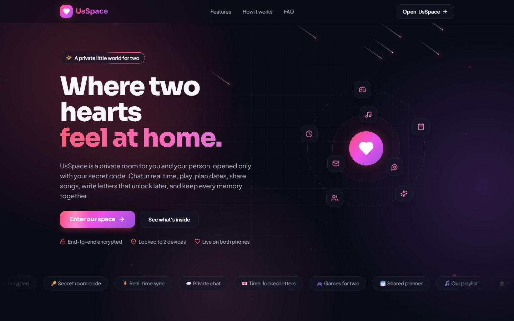

</div>

---

## What is UsSpace?

UsSpace is a private web app for **two people**. One of you **creates a room** and gets a **secret code**; the other **joins** with it. The room then **locks to your two devices**, everything is **end-to-end encrypted**, and when you **close the room, everything is deleted** — from the server and from both phones.

**Any number of couples can use the same website:** every couple creates their own room, and each room holds exactly two people.

### What's inside

| | Room | What you can do |
| --- | --- | --- |
| 🏠 | **Home** | Days together + **milestones** (1,000 days, 1,500 days…), a turning **3D heart**, a **question of the day** (your partner's answer opens once you answer too), a **countdown to your next time together**, **notes for each other**, mood check-in, love note of the day, one-tap call buttons |
| 💋 | **Thumb kiss** | Both put a thumb on the screen — when your thumbs meet, both phones buzz and show a kiss. Your partner gets a "join" invite |
| 👤 | **Profile** | Your **profile photo**, name and together-since date, your secret code and share link, **PIN lock**, notifications, and a separate **Log out** button |
| 💬 | **Chat** | Real-time messages, **photos and videos up to 2 minutes from your camera** (or your gallery), emoji, reactions, *typing…*, ticks (🕓 sending · ✓ sent · ✓✓ seen). Opens at your **newest message** |
| 📞 | **Calls** | **Voice and video calls** that work on every network: phone to phone when possible, otherwise through the UsSpace server (still encrypted). Mute, camera on/off, switch camera, minimise and keep talking |
| 💖 | **Missing you** | One tap — your partner gets hearts + "💖 Riya is missing you", or a 💖 message waiting if they're offline |
| 🖼️ | **Gallery** | Upload as many photos as you like, both see them live, "Show to Kabir", and **voice chat while you look** |
| 🎨 | **Canvas** | Draw together on a board that **grows as you draw** (pen, neon, eraser, colours, stickers, photos), scroll tool, undo, save as PNG |
| 🎮 | **8 games** | Tic-Tac-Toe, Connect Four, How Well Do You Know Me?, Rock Paper Scissors, Never Have I Ever, Truth or Dare, Memory Match, Would You Rather — **invite your partner; the game starts only when they join** |
| 🎵 | **Music** | **Your own songs** from the `music` folder, **in sync on both phones**. Keeps playing on every page; control it from the 🎵 button, your lock screen or headphones |
| 🔔 | **Notifications** | Install UsSpace on your home screen and get calls, messages and hearts even when it's in the background (never showing what a message says) |

### Fast on every phone

Pages switch in about **0.1–0.3 s**: only the landing page loads first, each room is fetched in the background while you look around, the new page appears at once (no waiting for the old one to fade out), heavy glass blur is lighter on phones, and the server sends files **Brotli-compressed**.

### Ideas from popular couple apps — all free here

The newest rooms follow what couples love in apps like Paired, Between and Couple: a **daily question** you both answer, a **thumb kiss**, a **countdown** to your next date, **notes** for each other and **milestones**. In UsSpace they cost nothing, need no account, and stay end-to-end encrypted.

### Screenshots

| | |
| --- | --- |
| 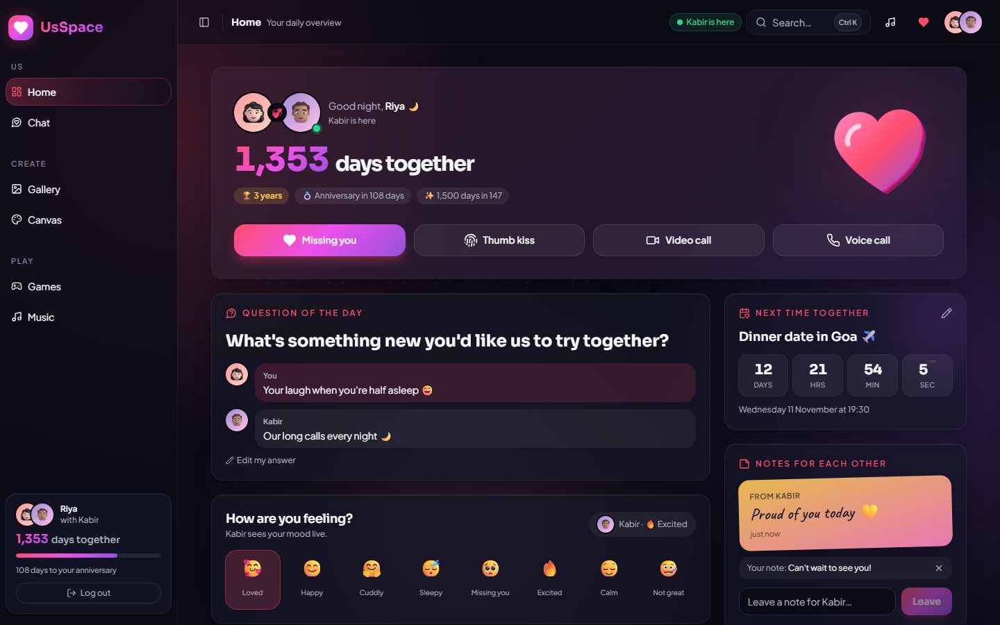 | 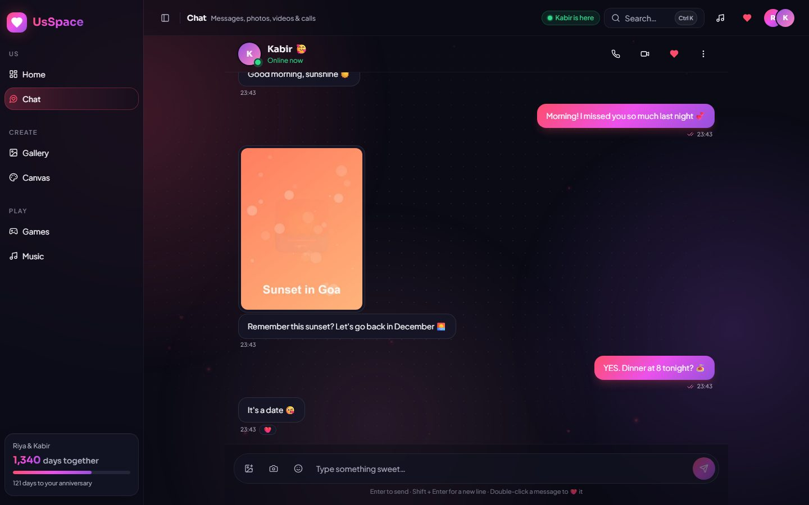 |
| **Home**: days together, question of the day, countdown, notes, mood | **Chat**: live messages, photos, videos, reactions, ticks |
| 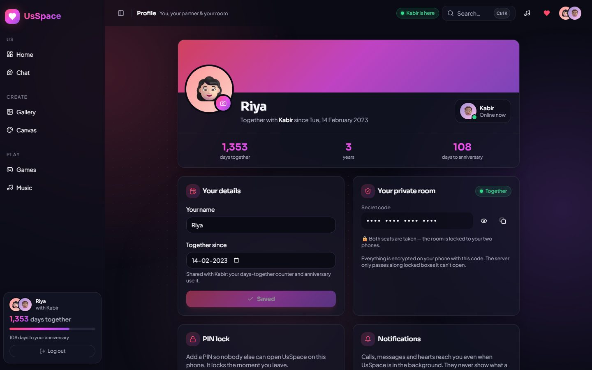 | 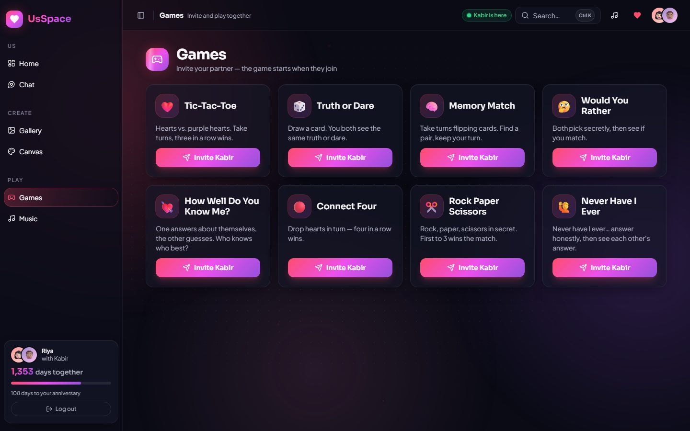 |
| **Profile**: photo, name, your date, secret code, PIN, log out | **Games**: 8 two-player games |
| 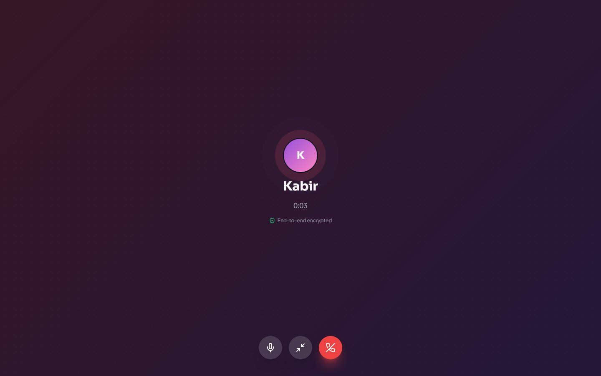 | 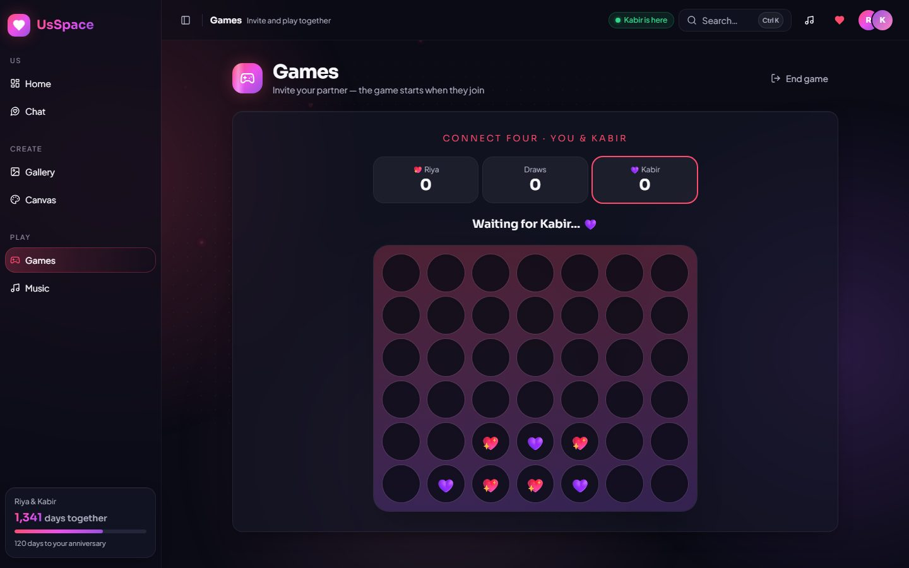 |
| **Calls**: voice and video, encrypted | **Connect Four**: four in a row wins |
| 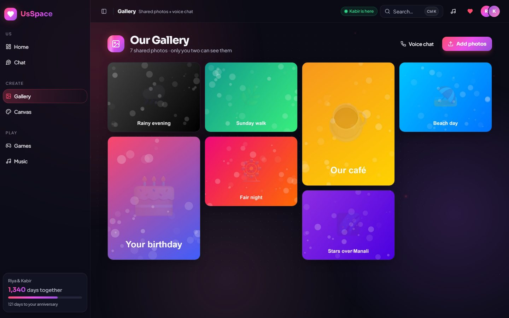 | 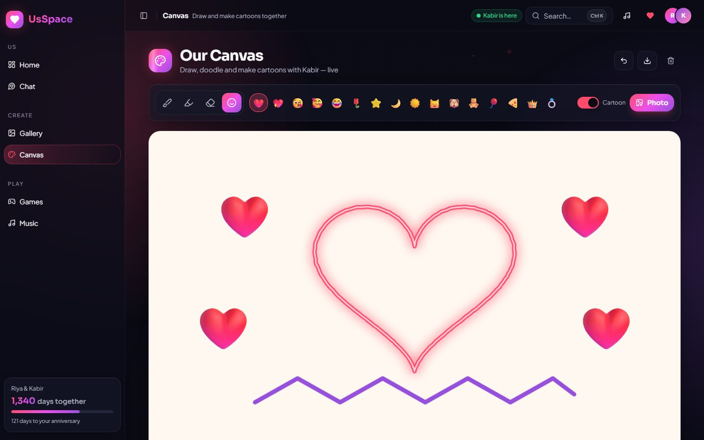 |
| **Gallery**: shared photos + voice chat | **Canvas**: draw together on a board that grows |
| 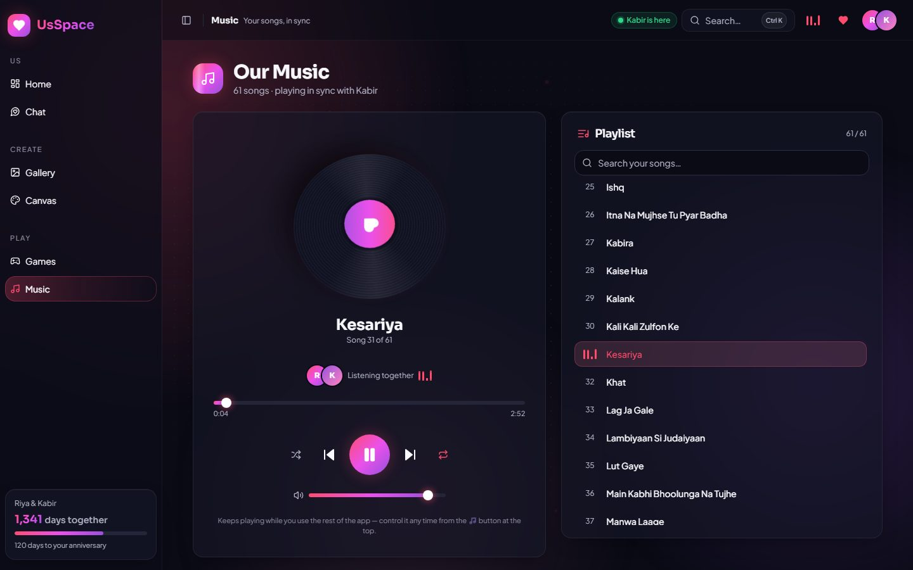 | 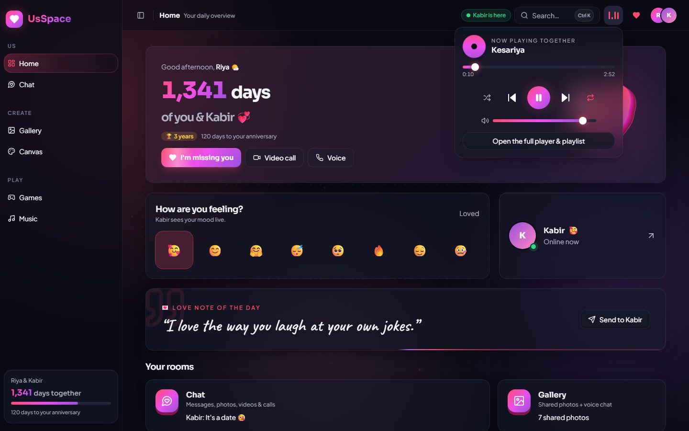 |
| **Music**: your songs, in sync, with search | **🎵 top bar**: control the music from any page |

<p align="center">
  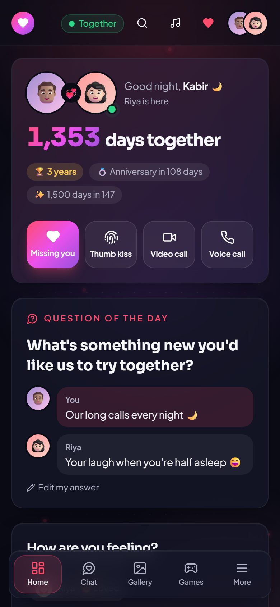
  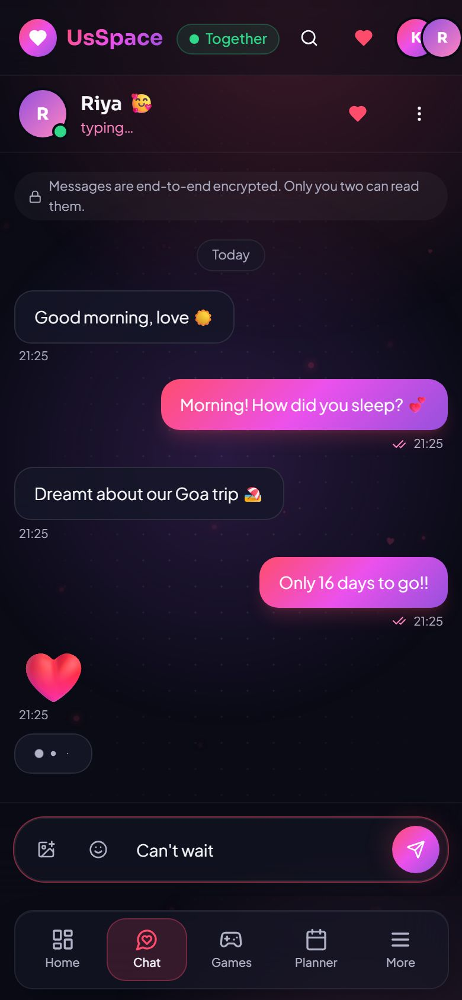
  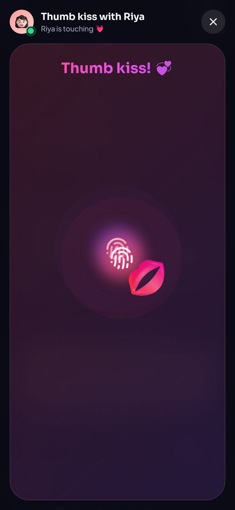
  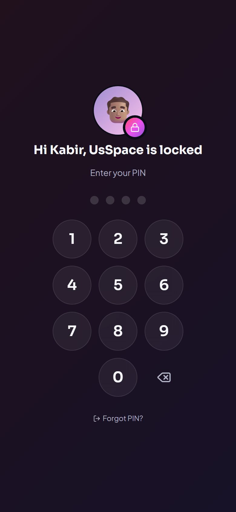
</p>

---

## 🔐 Security

| | |
| --- | --- |
| 🔑 **Secret code** | 16 random characters (80 bits), made on your phone. Never sent to the server. |
| 🔒 **End-to-end encryption** | Messages, photos, videos, drawings, names, call set-up — all locked on your phone (XChaCha20-Poly1305) with a key made from the code. The server only passes **locked boxes it can't open**. |
| 🚪 **2-device lock** | A room holds exactly two devices. A third person is refused — even with the right code. |
| 🧨 **Close room = delete everything** | Profile → *Close room & delete everything*: the server deletes the room, **both phones wipe their copy**, and the code can never be used again. A phone that was offline wipes itself the moment it comes back. |
| 💾 **The server forgets** | Rooms live **in memory only**, and a message is dropped from the server as soon as **both phones have saved it**. The optional database stores only "this room is closed" and "these two devices own this room" — never content. |
| 📞 **Private calls** | Set up through your encrypted room. Audio/video go phone-to-phone (encrypted by the browser), or — when a network blocks that — through the server, **encrypted with your room key**. |
| 🔢 **Instant PIN lock** | Optional PIN on each phone (only a slow PBKDF2-SHA256 hash is kept, 150 000 rounds). UsSpace locks **the moment you switch tabs, minimise the browser or lock your phone** — and when it opens. Calls and music keep going behind the lock. 5 wrong tries → 30 s wait, even after a reload. |
| 🖼️ **Profile photo without a database** | Your photo is made small on your phone (320 px), sent **end-to-end encrypted** to your partner and kept only on your two phones. The server forgets it once it's delivered; closing the room deletes it. |
| 🌫️ **Privacy blur** | Without a PIN, the app still blurs itself in the app switcher. Notifications never show message text. |
| 🛡️ **Anti-guessing** | Wrong codes are rate-limited per IP; a room locks for a while after 10 wrong tries. |
| 🧱 **Hardened server** | Strict Content-Security-Policy, camera/mic for this site only, no framing, size, speed and memory limits. |

**Honest limits:** anyone who unlocks *your phone* can open the app (use the PIN lock); a photo or video you save leaves the app; a call can only ring while UsSpace is open or installed with notifications on.

---

## Quick start (on your computer)

You need **Node.js 18.18+** (20 recommended).

```bash
cd front-end
npm install
npm run dev
```

Open **http://localhost:8080** — the website and the live server run together.
To try it alone: open a normal window and a private window, create a room in one, join in the other.

> Camera, microphone, calls and notifications need **https** or **localhost**. On another phone over your Wi-Fi (`http://192.168.x.x:8080`), chat works, but calls need the deployed https version.

### 🎵 Adding your music

1. Put your downloaded songs (`.mp3`, `.m4a`, `.ogg`, `.wav`, `.flac`, `.opus`) in **`front-end/public/music/`**.
2. Restart `npm run dev` (or redeploy). They appear in the Music room automatically — the file name becomes the song title.
3. **Control it:** the Music page has the full player and a searchable playlist; on every other page tap **🎵** in the top bar. Play, pause, seek, next and shuffle are shared by both phones. Volume is per phone.

---

## Deploy for free (Render)

1. Push this repository to GitHub.
2. On **render.com** → *New → Web Service* → pick the repository.
3. Settings: **Root Directory** `front-end` · **Build** `npm ci && npm run build` · **Start** `npm start` · **Instance** *Free*.
4. Environment variables:

| Key | Value | Needed? |
| --- | --- | --- |
| `TRUST_PROXY` | `1` | **Yes** (correct rate limits behind Render's proxy) |
| `NODE_VERSION` | `20` | Recommended |
| `UPSTASH_REDIS_REST_URL` + `UPSTASH_REDIS_REST_TOKEN` | from your free Upstash database | Recommended — makes *Close room* and the 2-device lock survive restarts |
| `CLOUDFLARE_TURN_KEY_ID` + `CLOUDFLARE_TURN_API_TOKEN` | from Cloudflare Realtime → TURN | Optional — best call quality on strict mobile networks |

5. Open your `https://…onrender.com` link on both phones — one creates, one joins. Tip: *Add to Home Screen* and turn on notifications in **Profile**.

**Free-plan notes:** the server sleeps after 15 min without visitors (first open ≈ 1 min). When it restarts, your phones re-upload what's missing automatically.

### Optional free extras (no rebuild needed — just add the variables)

| Extra | Why | How |
| --- | --- | --- |
| **Upstash Redis** (free, no card) | A closed room can never come back, and the 2-device lock survives restarts. Stores no content. | [upstash.com](https://upstash.com) → create a Redis database → copy the **REST URL** and **REST token** (Connect → REST) into the two variables. |
| **Cloudflare TURN** (first 1,000 GB / month free) | Direct calls on every mobile network, in full quality. Without it, calls that can't connect directly still work through the UsSpace server, with lower video quality. | Cloudflare dashboard → **Realtime → TURN** → create a TURN key → copy its **key ID** and **API token** into the two variables. Any other TURN service works too: `TURN_URLS`, `TURN_USERNAME`, `TURN_CREDENTIAL`. |

A **Dockerfile** is also included (`docker build -t usspace front-end`).

---

## Commands (inside `front-end/`)

| Command | What it does |
| --- | --- |
| `npm run dev` | Website + live server, auto-reload (port 8080) |
| `npm run build` / `npm start` | Production build / production server |
| `npm test` | 99 unit, page and server tests |
| `npm run test:e2e` | 18 real-browser tests (desktop + phone): create, join, chat, profile photo, question of the day, thumb kiss, **instant PIN lock**, games, **video calls direct and through the server** (`npx playwright install chromium` once) |
| `npm run typecheck` · `npm run lint` | Type and code checks |

---

## Project structure

```
usspace-your-private-haven/
├── README.md            ← you are here
└── front-end/
    ├── public/music/      ← 🎵 put your songs here
    ├── src/pages/         Landing, Start (create/join), Home, Chat, Gallery, Canvas, Games, Music, Profile, 404
    ├── src/components/home/  question of the day, countdown, notes, thumb kiss
    ├── src/call/          voice & video calls (WebRTC + the encrypted backup path)
    ├── src/music/         one music player for the whole app + 🎵 controls
    ├── src/sync/          encryption, shared-data engine, live connection
    ├── src/components/    effects (3D heart…), layout (menu, lock screen, log out), chat camera, 8 games
    ├── src/test/          tests
    ├── server/            relay (rooms, locks, limits, call backup), TURN, database, production server
    ├── e2e/               two-browser tests
    └── doc/               5 easy-English guides + screenshots
```

## Documentation

| Guide | What's inside |
| --- | --- |
| [1 · Problem & Solution](front-end/doc/01-problem-and-solution.md) | The problem, the website, who it's for |
| [2 · Approaches](front-end/doc/02-approaches.md) | How it's built, security, real-time sync, calls, the database, testing, bugs fixed |
| [3 · Design](front-end/doc/03-design.md) | Fonts, colours, motion, 3D effects, templates |
| [4 · Flowcharts](front-end/doc/04-flowcharts.md) | Diagrams of every flow |
| [5 · Directory Map](front-end/doc/05-directory-map.md) | Every folder and file |
| [Build prompt](front-end/doc/BUILD-PROMPT.md) | One detailed prompt to rebuild this exact website with any coding agent |

<div align="center">

Made with 💗 for the ones you love.

</div>
