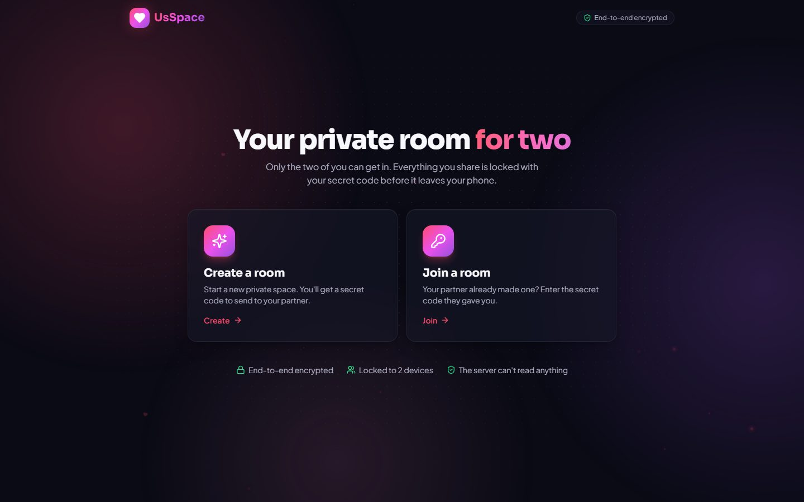
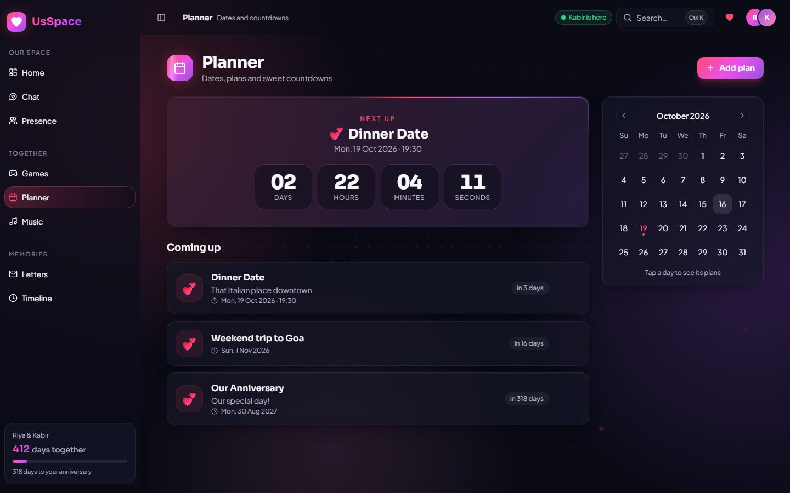
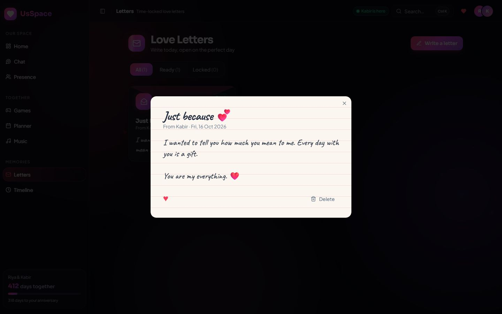
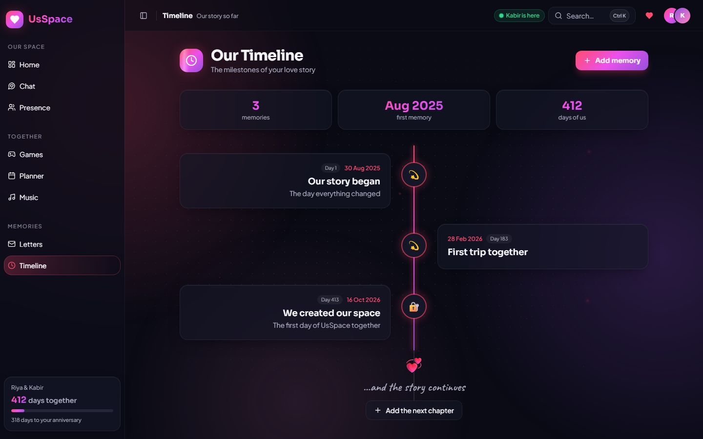
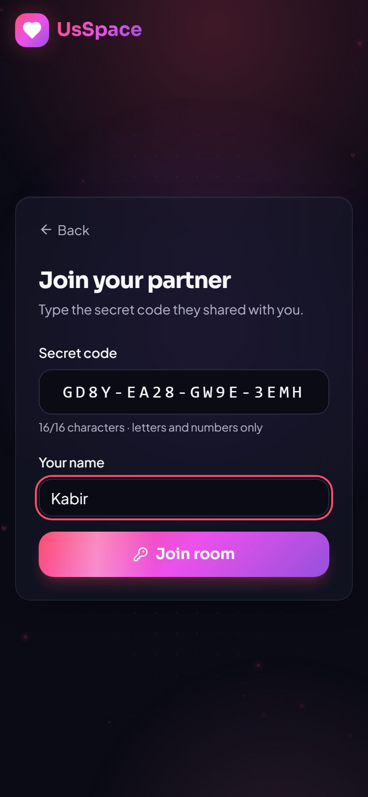

<div align="center">

# 💗 UsSpace

### *Your private little world, made for two.*

A locked room for two people, opened with a secret code. Chat, play, plan, listen, write and remember, **live on both phones** and **end-to-end encrypted**.


</div>

---

## What is UsSpace?

Couples share many small, special moments, but those moments are scattered across chat apps, calendars, photo galleries and notes. **UsSpace** gives a relationship **one beautiful, private home online**.

### How it works

1. **Create a room.** Enter your name and the day your story began. UsSpace makes a **secret code** (like `NJ4Q-0JPY-9BBC-ASCS`) and a QR code, right on your phone.
2. **Share the code** with your partner (copy, share or let them scan the QR).
3. **They join.** The room **locks** to your two devices. Nobody else can get in, even with the code.
4. **Enjoy everything together, live.** Every message, mood, plan, letter, game move and song shows up on both phones instantly.

| | Room | What you can do |
| --- | --- | --- |
| 🏠 | **Home** | Days together, anniversary countdown ring, mood check-in, love note of the day, live cards for every room |
| 💬 | **Chat** | Real-time messages, photos, emoji, reactions, **typing…**, and ticks (🕓 sending · ✓ sent · ✓✓ seen) |
| 👥 | **Presence** | Online / last seen, moods and status, and "thinking of you" nudges that pop up on your partner's phone |
| 🎮 | **Games** | Two-player **Tic-Tac-Toe** across both phones, a shared **Truth or Dare** card, **Memory Match**, **Would You Rather** |
| 📅 | **Planner** | Shared plans, live countdown, calendar, and a notification when your partner adds one |
| 🎵 | **Music** | Shared playlist with one **shared playback timeline**: play on one phone and the other follows to the second |
| 💌 | **Letters** | Love letters locked until a day you choose, with "Read by …" receipts |
| 🕰️ | **Timeline** | Your love story as a glowing line of shared milestones |

Plus heart bursts, quick search (**Ctrl + K** / **⌘ + K**), a live connection pill, a profile & room panel, and a friendly 404 page.

---

## 🔐 Security in one minute

| | |
| --- | --- |
| 🔑 **Secret code** | 16 random characters (80 bits), made on your phone. **Never sent to the server.** |
| 🔒 **End-to-end encryption** | Everything is locked on your phone with a key made from the code (XChaCha20-Poly1305). The server only passes along **locked boxes it can't open**. |
| 🚪 **2-device lock** | A room holds exactly two devices. A third person gets "This room already has two people". |
| 🛡️ **Guessing protection** | Wrong codes are rate-limited per IP, and a room locks for a while after 10 wrong tries. |
| 🧱 **Hardened server** | Strict Content-Security-Policy, no framing, size and speed limits, and a safe file server. |
| 📴 **Local-first** | Each phone keeps its own copy, so it works offline and syncs when back online. |

Full details, including the honest limits, are in [Approaches → Security and privacy](front-end/doc/02-approaches.md#24-security-and-privacy).

---

## Screenshots

| Create or join | Your secret code |
| --- | --- |
|  |  |
| **Home** | **Real-time chat** |
|  |  |
| **Planner** | **Two-player games** |
|  |  |
| **Letters** | **Timeline** |
|  |  |

| Join on a phone | Chat on a phone | Music, in sync |
| --- | --- | --- |
|  |  |  |

---

## Quick start

You need **Node.js 18.18 or newer** (Node 20 recommended).

```bash
cd front-end
npm install
npm run dev
```

Open **http://localhost:8080**. The website **and** the real-time relay both run on this one address.

### Try it with two people

- **On one computer:** open a normal window and a private/incognito window. Create a room in one and join it in the other.
- **Two phones on the same Wi-Fi:** run `npm run dev`, then open `http://<your-computer's-IP>:8080` on both phones (the IP is printed in the terminal as "Network").
- **Anywhere in the world:** deploy it (see below) and open the same address on both phones.

### Useful commands (inside `front-end/`)

| Command | What it does |
| --- | --- |
| `npm run dev` | Website + relay with live reload (port 8080) |
| `npm run build` | Production build in `dist/` |
| `npm start` | Production server: serves `dist/` + the relay, with security headers (port 8080) |
| `npm test` | 79 unit, page and server tests |
| `npm run test:e2e` | 10 real-browser tests: two browsers create, join and chat live (run `npx playwright install chromium` once first) |
| `npm run typecheck` | TypeScript check |
| `npm run lint` | Code style (app + server) |

---

## Deploy

UsSpace is **one small Node.js app**. Any host that runs Node and supports WebSockets works (Render, Railway, Fly.io, a VPS…).

```bash
cd front-end
npm ci
npm run build
npm start          # PORT=8080 by default
```

| Setting (environment variable) | Use |
| --- | --- |
| `PORT` | Port to listen on |
| `USSPACE_DATA_DIR` | Where encrypted rooms are saved. Use a **persistent disk** |
| `ALLOWED_ORIGINS` | e.g. `https://our.usspace.app`, so only your site can connect to the relay |
| `TRUST_PROXY=1` | Behind a proxy / load balancer, so rate limits see real IPs |

Always serve it over **HTTPS** (most hosts do this for you).

A **Dockerfile** is included (`docker build -t usspace front-end` and `docker run -p 8080:8080 -v usspace-data:/data usspace`). It wasn't built during this update because Docker wasn't running on the build machine, so run it once yourself to confirm.

To host the website and the relay on **different** addresses, set `VITE_SYNC_URL` when building (see `front-end/.env.example`).

---

## Built with

**React 18** · **TypeScript** · **Vite 5** · **Tailwind CSS** · **shadcn/ui + Radix UI** · **Framer Motion** · **Node.js + ws** · **@noble/ciphers + @noble/hashes** · **React Router** · **lucide** · **sonner** · **cmdk** · **qrcode** · **Vitest** · **Playwright**

Design: a night-sky dark theme, frosted-glass cards, a rose → violet gradient, the **Sora**, **Plus Jakarta Sans** and **Caveat** fonts, and animations inspired by 60+ modern UI template patterns.

---

## Project structure

```
usspace-your-private-haven/
├── README.md          ← you are here
└── front-end/         ← the website + its real-time relay
    ├── doc/             5 easy-English guides + screenshots
    ├── src/pages/       one file per screen (incl. Start: create / join)
    ├── src/sync/        encryption, shared-data engine, live connection
    ├── src/components/  effects, layout, games, forms, UI kit
    ├── src/lib/         storage, dates, game rules, words, starter content
    ├── src/test/        79 tests
    ├── server/          relay server + production server
    └── e2e/             two-browser tests
```

The full map is in [front-end/doc/05-directory-map.md](front-end/doc/05-directory-map.md).

---

## Documentation

| # | Guide | What's inside |
| --- | --- | --- |
| 1 | [Problem & Solution](front-end/doc/01-problem-and-solution.md) | The problem, what the website is, how rooms work, who the users are |
| 2 | [Approaches](front-end/doc/02-approaches.md) | How it was built, architecture, **security**, **real-time sync**, testing, **all bugs fixed**, what's next |
| 3 | [Design](front-end/doc/03-design.md) | Fonts, colours (hex), gradients, motion timings, room screens, connection states, 60+ template patterns |
| 4 | [Flowcharts](front-end/doc/04-flowcharts.md) | 24 diagrams: create, join, keys, how a message travels, server checks, offline catch-up, every room |
| 5 | [Directory Map](front-end/doc/05-directory-map.md) | Every folder and file explained, with a mind map and dependency graph |

---

## What's next

Install as an app (PWA) with push notifications, encrypted photo and voice storage for bigger media, an optional app lock (PIN / fingerprint), approved extra devices, real Spotify / YouTube audio sync, and a light theme. See [Approaches → What comes next](front-end/doc/02-approaches.md#29-what-comes-next).

<div align="center">

Made with 💗 for the ones you love.

</div>
