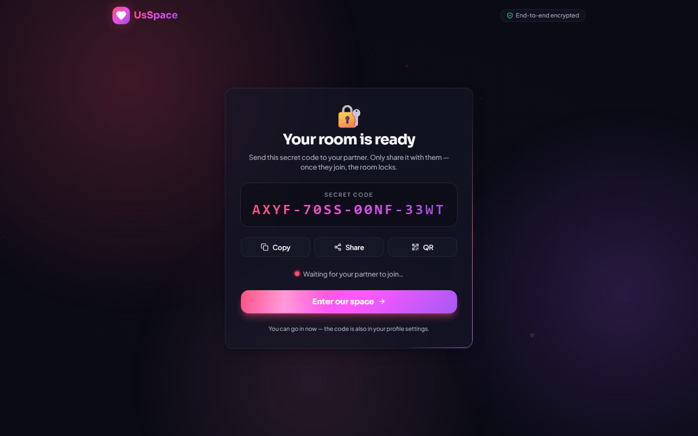
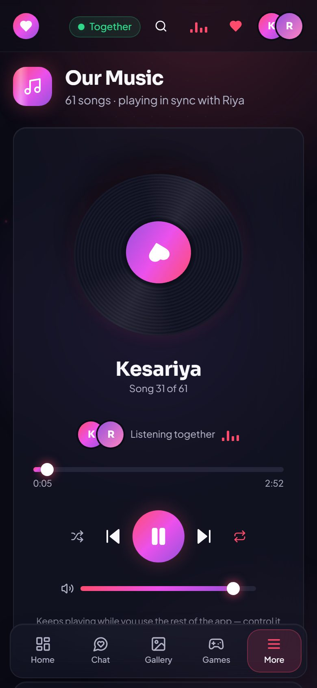

<div align="center">

# 💗 UsSpace

### *A private, locked room for two — chat, call, draw, play and listen together, live.*


</div>

---

## What is UsSpace?

UsSpace is a private web app for **two people**. One of you **creates a room** and gets a **secret code**; the other **joins** with it. The room then **locks to your two devices**, everything is **end-to-end encrypted**, and when you **close the room, everything is deleted** — from the server and from both phones.

### What's inside

| | Room | What you can do |
| --- | --- | --- |
| 🏠 | **Home** | Days together, a turning **3D heart**, mood check-in, love note of the day, quick call buttons |
| 💬 | **Chat** | Real-time messages, **photos and short videos from your camera** (live capture or from your gallery), emoji, reactions, *typing…*, and ticks (🕓 sending · ✓ sent · ✓✓ seen) |
| 📞 | **Calls** | **Voice and video calls**, phone to phone: mute, camera on/off, switch camera, minimise and keep talking |
| 💖 | **Missing you** | One tap — your partner gets hearts + "💖 Riya is missing you" right away, or a 💖 message waiting if they're offline |
| 🖼️ | **Gallery** | Upload as many photos as you like, both see them live, "Show to Kabir", and **voice chat while you look** |
| 🎨 | **Canvas** | Draw together (pen, neon, eraser, colours), stickers, add photos with a **cartoon filter**, undo, save as PNG |
| 🎮 | **Games** | Tic-Tac-Toe, Truth or Dare, Memory Match, Would You Rather — **invite your partner; the game starts only when they join** |
| 🎵 | **Music** | Plays **your own songs** from the `music` folder, **in sync on both phones** (play, pause, seek, skip, shuffle, repeat, search). It **keeps playing on every page**: control it from the 🎵 button at the top, or from your lock screen and headphones |

### Screenshots

| | |
| --- | --- |
|  |  |
| **Home**: days together, 3D heart, mood, love note, calls | **Chat**: live messages, photos, videos, reactions, ticks |
|  |  |
| **Gallery**: shared photos + voice chat | **Canvas**: neon pen, stickers, cartoon photos |
|  |  |
| **Music**: your songs, in sync, with search | **🎵 top bar**: control the music from any page |
|  |  |
| **Games**: invite → partner joins → play | **Secret code**: copy, share or QR |

<p align="center">
  
  
  
</p>

---

## 🔐 Security

| | |
| --- | --- |
| 🔑 **Secret code** | 16 random characters (80 bits), made on your phone. Never sent to the server. |
| 🔒 **End-to-end encryption** | Messages, photos, videos, drawings, names — all locked on your phone (XChaCha20-Poly1305) with a key made from the code. The server only stores and passes **locked boxes it can't open**. |
| 🚪 **2-device lock** | A room holds exactly two devices. A third person is refused — even with the right code. |
| 🧨 **Close room = delete everything** | Settings → *Close room & delete everything*: the server deletes the room, **both phones wipe their copy**, and the code can never be used again. |
| 💾 **Nothing on disk** | The server keeps rooms **in memory only** (unless you choose a folder). A restart leaves nothing behind. |
| 🔢 **PIN lock** | Optional PIN on each phone (hashed with PBKDF2-SHA256, 150 000 rounds). Asked on open and after 30 s away. 5 wrong tries → 30 s wait. |
| 🌫️ **Privacy blur** | The app blurs itself when you switch apps, so it doesn't show in the app switcher. |
| 📞 **Private calls** | Calls are set up through your encrypted room and go **directly phone-to-phone** (WebRTC, encrypted by the browser). |
| 🛡️ **Anti-guessing** | Wrong codes are rate-limited per IP; a room locks for a while after 10 wrong tries. |
| 🧱 **Hardened server** | Strict Content-Security-Policy, camera/mic allowed for this site only, no framing, size and speed limits, safe file serving. |

**Honest limits:** anyone who unlocks *your phone* can open the app (use the PIN lock); some strict mobile networks block direct calls (see *TURN* below); a photo saved with "Save" leaves the app.

---

## Quick start (on your computer)

You need **Node.js 18.18+** (20 recommended).

```bash
cd front-end
npm install
npm run dev
```

Open **http://localhost:8080** — the website and the live server run together.
To try it alone: open a normal window and a private window, create a room in one, join in the other.

> Camera, microphone and calls need **https** or **localhost**. On another phone over your Wi-Fi (`http://192.168.x.x:8080`), chat works but calls/camera need the deployed https version.

### 🎵 Adding your music

1. Put your downloaded songs (`.mp3`, `.m4a`, `.ogg`, `.wav`, `.flac`, `.opus`) in **`front-end/public/music/`**.
2. Restart `npm run dev` (or redeploy). They appear in the Music room automatically — the file name becomes the song title.
3. **Control it:** the Music page has the full player and a searchable playlist. On every other page, tap **🎵** in the top bar (it shows bouncing bars while music plays). Play, pause, seek, next and shuffle are shared by both phones. Volume is per phone.

> Big folders are fine: songs stream in small parts only while playing, so opening the app doesn't download any music.

---

## Deploy for free (Render)

1. Push the `front-end` folder to a GitHub repository.
2. On **render.com** → *New → Web Service* → pick the repo.
3. Settings: **Build** `npm ci && npm run build` · **Start** `npm start` · **Instance** *Free* · Root Directory empty (or `front-end`).
4. Environment variables:

| Key | Value | Needed? |
| --- | --- | --- |
| `TRUST_PROXY` | `1` | **Yes** (correct rate limits behind Render's proxy) |
| `NODE_VERSION` | `20` | Recommended |
| `ALLOWED_ORIGINS` | `https://your-app.onrender.com` | Recommended |
| `USSPACE_DATA_DIR` | *(leave empty)* | Empty = memory only (nothing stored on disk) |

5. Open your `https://…onrender.com` link on both phones — one creates, one joins.

**Free-plan notes:** it sleeps after 15 min idle (first open ≈ 1 min). When the server restarts, rooms are rebuilt automatically from your phones (unless you closed them).

### Optional: TURN server for calls on strict networks

Most calls connect directly. If calls fail on some mobile networks, add a free TURN server (e.g. a free *Metered* or *ExpressTURN* account) and set these **before building**:

```
VITE_TURN_URL=turn:your-turn-host:3478
VITE_TURN_USERNAME=...
VITE_TURN_CREDENTIAL=...
```

A **Dockerfile** is also included (`docker build -t usspace front-end`).

---

## Commands (inside `front-end/`)

| Command | What it does |
| --- | --- |
| `npm run dev` | Website + live server, auto-reload (port 8080) |
| `npm run build` / `npm start` | Production build / production server |
| `npm test` | 79 unit, page and server tests |
| `npm run test:e2e` | 12 real-browser tests (desktop + phone): two people create, join, chat, play and **video call** (`npx playwright install chromium` once) |
| `npm run typecheck` · `npm run lint` | Type and code checks |

---

## Project structure

```
usspace-your-private-haven/
├── README.md            ← you are here
└── front-end/
    ├── public/music/      ← 🎵 put your songs here
    ├── src/pages/         Landing, Start (create/join), Home, Chat, Gallery, Canvas, Games, Music, 404
    ├── src/call/          voice & video calls (WebRTC)
    ├── src/music/         one music player for the whole app + 🎵 controls
    ├── src/sync/          encryption, shared-data engine, live connection
    ├── src/components/    effects (3D heart, spotlight cards…), layout, chat camera, games
    ├── src/test/          tests
    ├── server/            relay (rooms, locks, limits) + production server + music list
    ├── e2e/               two-browser tests
    └── doc/               5 easy-English guides + screenshots
```

## Documentation

| Guide | What's inside |
| --- | --- |
| [1 · Problem & Solution](front-end/doc/01-problem-and-solution.md) | The problem, the website, who it's for |
| [2 · Approaches](front-end/doc/02-approaches.md) | How it's built, security, real-time sync, calls, testing, bugs fixed |
| [3 · Design](front-end/doc/03-design.md) | Fonts, colours, motion, 3D effects, templates |
| [4 · Flowcharts](front-end/doc/04-flowcharts.md) | Diagrams of every flow |
| [5 · Directory Map](front-end/doc/05-directory-map.md) | Every folder and file |

<div align="center">

Made with 💗 for the ones you love.

</div>
