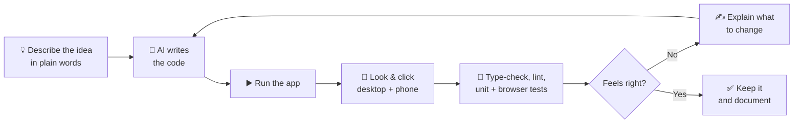
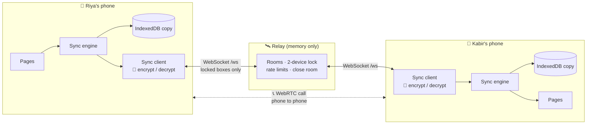

# 2 · Approaches (How We Built It, in Detail)

This page explains **how** UsSpace was made and **why** each choice was made, in simple words.

**Contents**

- [2.1 Building approach: vibe coding](#21-building-approach-vibe-coding)
- [2.2 Tech stack](#22-tech-stack)
- [2.3 Architecture](#23-architecture)
- [2.4 Security and privacy](#24-security-and-privacy)
- [2.5 Real-time sync](#25-real-time-sync)
- [2.6 Calls, camera and music](#26-calls-camera-and-music)
- [2.7 How each room works](#27-how-each-room-works)
- [2.8 Quality: testing and the bugs we fixed](#28-quality-testing-and-the-bugs-we-fixed)
- [2.9 What comes next](#29-what-comes-next)

---

## 2.1 Building approach: vibe coding

UsSpace was built with **vibe coding**:

> We describe the *feeling* and the *idea* in plain words ("a private room for two, with a secret code, calls, a shared canvas, music in sync"),
> an AI coding assistant writes the code, and a human **runs it, looks at it, tests it and asks for changes** until it feels right.

**Rules we kept:**

1. **Trust, but always check.** Every change is checked with `typecheck`, `lint`, unit tests, real-browser tests and a production build.
2. **Test like a real couple.** Live features are tested with **two browsers at once**, including a real video call with fake cameras.
3. **Small, clear pieces.** Each feature lives in its own file or folder.
4. **The website stays about love.** The site never talks about how it was built.

---

## 2.2 Tech stack

| Tool | What it is | Why we chose it |
| --- | --- | --- |
| **React 18 + TypeScript + Vite** | The app and its build tool | Fast, popular, and catches mistakes early |
| **Tailwind + shadcn/ui + Radix** | Styling + accessible parts | Quick to design, good for keyboards and screen readers |
| **Framer Motion + CSS 3D** | Animation | 3D page turns, tilting cards, the layered 3D heart |
| **Node.js + `ws`** | The tiny "relay" server | Real-time messages with almost no code |
| **@noble/ciphers + @noble/hashes** | Audited cryptography in pure JavaScript | Encryption + PIN hashing that work everywhere |
| **WebRTC** (built into browsers) | Voice and video calls | Phone to phone, encrypted by the browser, free |
| **IndexedDB** (built into browsers) | Storage on each phone | Big enough for photos and videos |
| **MediaRecorder / getUserMedia** | Camera photos and video clips | Built into browsers |
| **Media Session API** | Lock-screen and headphone music controls | Built into phones |
| **Vitest + Playwright** | Unit, page, server and two-browser tests | Checks everything, including calls |

---

## 2.3 Architecture

Everything lives in `front-end/`: the **website** (`src/`) and the **relay** (`server/`).

| Part | What it does | Where |
| --- | --- | --- |
| **Room provider** | Create, join, leave and close the room. Connection status, partner presence, typing, hearts, pop-ups | `src/context/RoomProvider.tsx` |
| **Sync engine + client** | Shared data (newest wins), outbox, catch-up, encryption | `src/sync/` |
| **Call provider** | Ringing, answering, WebRTC connection, call screen | `src/call/` |
| **Music provider** | One player for the whole app, synced timeline, lock-screen controls | `src/music/` |
| **App lock** | Optional PIN, privacy blur | `src/components/layout/AppLock.tsx` |
| **Relay** | Rooms, auth check, 2-device lock, rate limits, close room | `server/relay.mjs` |
| **Production server** | Website + relay + music files, security headers, seekable audio | `server/index.mjs` |

---

## 2.4 Security and privacy

### The secret code and four keys

The code is 16 random characters (80 bits), made **on your phone** and **never sent to the server**. From it, each phone works out (HKDF-SHA256):

| Key | Used for | Who sees it |
| --- | --- | --- |
| **Room id** | Which room | The server (it can't turn it back into the code) |
| **Auth key** | Proving you know the code | The server stores only its SHA-256 hash |
| **Encryption key** | Locking every message, photo, video, drawing, name… (XChaCha20-Poly1305) | **Only your two phones** |
| **Item key** | Anonymous labels for items | The server sees random-looking labels |

### Protections

| Protection | How it works |
| --- | --- |
| **2-device lock** | A room accepts exactly two devices. A third is refused, even with the right code. |
| **Close room = delete everything** | The server deletes the room right away, tells both phones to wipe their copy (IndexedDB + local storage), and remembers the room as closed for 30 days, so an offline phone can't bring it back. |
| **Memory-only server** | Rooms are kept in memory unless you set `USSPACE_DATA_DIR`. A restart leaves nothing on disk. |
| **PIN lock** | An optional 4–8 digit PIN per phone, hashed with PBKDF2-SHA256 (150 000 rounds). Asked on open and after 30 seconds in the background. 5 wrong tries → wait 30 seconds. |
| **Privacy blur** | The app blurs itself when it goes to the background (app switcher, screen sharing). |
| **Private calls** | Call set-up messages travel encrypted through the room. The audio and video go directly phone-to-phone (WebRTC uses DTLS-SRTP encryption). |
| **Anti-guessing** | Wrong codes use up "tries" per IP (15, then 1 every 5 seconds). A room locks for a while after 10 wrong tries. Correct reconnects are free. |
| **Limits** | Events up to 4 MB (photos and short videos), signals up to 64 KB, message rate limits, max windows per room, 60 MB per room. |
| **Website headers** | Strict Content-Security-Policy (including `media-src`), no framing, no-sniff, no referrer, and `Permissions-Policy` allowing the camera and mic **only for this site**. |

### Honest limits

- The PIN only locks the screen; the data saved on the phone is not encrypted with the PIN. Lock your phone too.
- Some strict mobile networks block direct calls. A **TURN** server fixes this (optional, see the README).
- Photos you **save** to your phone, or anything you screenshot, leave the app.
- The QR / invite link carries the code after a `#` (never sent to any server), but whoever receives it can read it.

---

## 2.5 Real-time sync

Everything shared is a small **item** (one message, one photo, one stroke, the music player, the game…). Every change is a **put**: the newest version of one item.

| Rule | Why |
| --- | --- |
| **Newest wins** (server time + device id) | Both phones always end up the same. |
| **Deletes are remembered** (60 days) | Old copies can't bring deleted things back. |
| **Written in the author's words**, so "me" becomes "partner" on the other phone | Pages can simply say "me" and "partner". |
| **Optimistic + outbox** | Your change shows instantly and waits (saved) until the server confirms. |
| **Catch-up by number** | Things sent while you were offline arrive when you're back. |
| **Saved one item at a time in IndexedDB** | Sending a photo doesn't re-save the whole chat. |
| **Saved all-or-nothing** | Items, the outbox and "how far I've caught up" are saved in one IndexedDB transaction, so a phone never thinks it has a message it didn't store. |
| **Signals** (typing, hearts, call messages) | Sent live, never stored. |
| **Self-healing** | If the server lost a room (restart), the first phone back re-creates it from its copy, unless the room was closed. |

---

## 2.6 Calls, camera and music

| Feature | Approach |
| --- | --- |
| **Calls** | WebRTC. Ring → accept → offer → answer, all as encrypted room signals. All network routes are gathered first and sent in one message. Free Google STUN servers; optional TURN through `VITE_TURN_*`. If you both call at the same moment, one phone automatically answers the other. The call screen can be minimised to a small bar so you can keep talking while you browse the gallery. |
| **Camera** | `getUserMedia` for a live preview. Photos become JPEG (max 1280 px). Videos are recorded with `MediaRecorder` (max 20 s, ~600 kbps, max 2.5 MB). |
| **Canvas** | Strokes and stickers are shared items with coordinates from 0 to 1000, so every screen size matches. Three stacked layers: paper + photos, ink (the eraser only rubs out ink), and your live stroke. The **cartoon filter** flattens colours into bands and draws dark outlines (Sobel edges). |
| **Music** | The server lists `public/music` at `/music/manifest.json`. **One player for the whole app** (it keeps playing on every page), controlled from the Music page or the 🎵 button in the top bar, with lock-screen and headphone controls (Media Session). Both phones play their own copy of the file, kept in step by a shared timeline `{song, playing, position, time}`. The server answers partial (Range) requests, so seeking is instant. |
| **Games** | A shared `game` item: *invited → playing*. Your partner gets a pop-up anywhere in the app. All 4 games are two-player, and turns are enforced. |
| **3D UI** | A CSS 3D heart made of 16 layers, 3D page turns (rotateX), tilting spotlight cards, 3D-pressed buttons, and flip effects in games and the gallery. Heavy effects pause for people who prefer less motion. |

---

## 2.7 How each room works

| Room | How it works (simple) |
| --- | --- |
| **Start** | *Create*: name + "together since" → a code is made on your phone → Copy / Share / QR. *Join*: code + name → you're in, and the room locks. |
| **Home** | Days together, the 3D heart, anniversary countdown, mood (shared live), love note of the day, "I'm missing you", video and voice call buttons, and live cards for every room. |
| **Chat** | Live messages with photos, videos (camera or gallery), emoji, reactions, typing and seen ticks. Long chats show the newest 80 messages first. Call buttons sit in the header. |
| **Gallery** | Upload many photos at once (shrunk to 1600 px). Masonry grid with 3D tilt, a full-screen viewer with swipe, "Show Kabir" (opens it on the other phone), save, delete with undo, and a voice-chat button. |
| **Canvas** | Draw, use neon, erase, place stickers, add photos with the cartoon filter, undo your own strokes, clear for both (with a warning), save as PNG. |
| **Games** | Choose a game → invite → your partner joins → play. "End game" goes back to the list. |
| **Music** | Your 61 songs (or however many you add), search, a spinning record, shared play / pause / seek / next / shuffle / repeat, and volume per phone. |
| **Settings** | Your name, the shared "together since" date, the secret code (hidden, reveal, copy), PIN lock, **Close room & delete everything**, or leave on this phone only. |

---

## 2.8 Quality: testing and the bugs we fixed

### Checks (inside `front-end/`)

| Command | What it checks | Result |
| --- | --- | --- |
| `npm run typecheck` | Types | ✅ |
| `npm run lint` | Code rules (app + server) | ✅ 0 errors (only warnings in generated UI files) |
| `npm test` | **79 tests**: encryption, sync engine (incl. safe saving), relay server, dates, games, storage, every page, game invites | ✅ |
| `npm run test:e2e` | **12 real-browser tests** (6 × desktop + phone): create/join, live chat, wrong code + full room, every room opens, **game invite + a real video call** | ✅ |
| `npm run build` / `npm start` | Production build and server (security headers, gzip, seekable music, health check) | ✅ |

We also checked the music with **two browsers** and the real song folder: 61 songs listed, search works, it plays, it keeps playing on other pages, the partner sees "Now playing", and pause stops it for both.

### Bugs fixed (highlights)

| Round | Bug | Fix |
| --- | --- | --- |
| 1 | Empty page for unknown links, stuck countdowns, wrong days (UTC), always-locked letters, unreachable pages on phones, no tic-tac-toe winner, nothing saved, builder branding | Fixed in the redesign (26 fixes) |
| 2 | Fake demo replies, always-"seen" ticks, a guessing limit that blocked correct reconnects, "Happy anniversary" on day one, screen-reader gaps | Real partner messages, real ticks, fair limits, correct anniversary, labels |
| 3 | A glow sat **on top of the Accept call button**, so calls couldn't be answered | The button now sits above the glow |
| 3 | Call buttons **moved on hover**, which made them hard to tap | They stay still and give feedback on press |
| 3 | **Music stopped when you left the Music page** | One player for the whole app + 🎵 controls in the top bar |
| 3 | The server sent the **whole song** when only part was asked for, which made seeking slow | Proper partial (206) answers |
| 3 | localStorage (≈5 MB) was too small for photos and videos | IndexedDB, saved one item at a time |
| 3 | If the app closed within ~0.3 s of a message arriving, the phone could **lose that message for good** (it saved "I have message N" before saving the message) | The message, the outbox and "I have message N" are now saved **together in one step**, also when the app goes to the background |
| 3 | Every app open **downloaded a whole song** even when nothing was playing (wasted phone data) | Only the song length is loaded until you press play |
| 3 | Typing right after opening the app didn't show "typing…" to your partner | The typing signal retries until it's really sent |
| 3 | Gallery photo cards had an **empty strip under every photo** (the hover caption took up space) | The caption now sits on top of the photo |
| 3 | On phones, the new 🎵 button **pushed the profile button off the screen** | Narrow phones show just the heart logo in the top bar |
| 3 | The landing page still talked about **plans, letters and timelines** that no longer exist | New text, icons and live demos for calls, gallery, canvas, close room and hearts |
| 3 | Double-clicking a message to ❤️ it also **selected a word** | The selection is cleared |

---

## 2.9 What comes next

| Idea | Why |
| --- | --- |
| Install as an app (PWA) + push notifications | "💖 Riya is missing you" even when the app is closed |
| A built-in free TURN option | Calls on every mobile network |
| Encrypt the phone's copy with the PIN | Stronger protection if someone unlocks the phone |
| Voice notes in chat | Quick and sweet |
| Light theme | A soft "morning" look |

**Back:** [← 1 · Problem & Solution](01-problem-and-solution.md) · **Next:** [3 · Design →](03-design.md)
