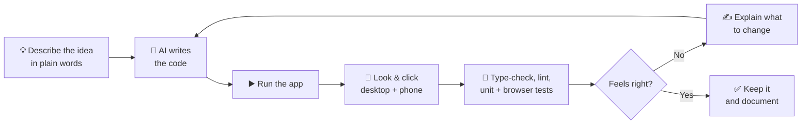
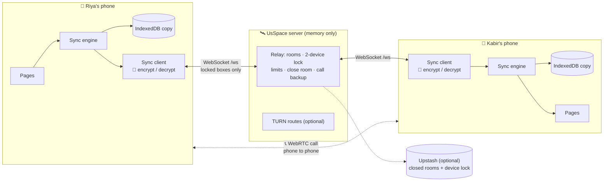

# 2 · Approaches (How We Built It, in Detail)

This page explains **how** UsSpace was made and **why** each choice was made, in simple words.

**Contents**

- [2.1 Building approach: vibe coding](#21-building-approach-vibe-coding)
- [2.2 Tech stack](#22-tech-stack)
- [2.3 Architecture](#23-architecture)
- [2.4 Security and privacy](#24-security-and-privacy)
- [2.5 Real-time sync](#25-real-time-sync)
- [2.6 Calls](#26-calls)
- [2.7 Camera, canvas, games, music and notifications](#27-camera-canvas-games-music-and-notifications)
- [2.8 The optional free database](#28-the-optional-free-database)
- [2.9 How each room works](#29-how-each-room-works)
- [2.10 Quality: testing and the bugs we fixed](#210-quality-testing-and-the-bugs-we-fixed)
- [2.11 What comes next](#211-what-comes-next)

---

## 2.1 Building approach: vibe coding

UsSpace was built with **vibe coding**:

> We describe the *feeling* and the *idea* in plain words ("a private room for two, with a secret code, calls, a shared canvas, music in sync"),
> an AI coding assistant writes the code, and a human **runs it, looks at it, tests it and asks for changes** until it feels right.

**Rules we kept:**

1. **Trust, but always check.** Every change is checked with `typecheck`, `lint`, unit tests, real-browser tests and a production build.
2. **Test like a real couple.** Live features are tested with **two browsers at once**, including real video calls, both phone-to-phone and through the server.
3. **Small, clear pieces.** Each feature lives in its own file or folder.
4. **The website stays about love.** The site never talks about how it was built.

---

## 2.2 Tech stack

| Tool | What it is | Why we chose it |
| --- | --- | --- |
| **React 18 + TypeScript + Vite** | The app and its build tool | Fast, popular, and catches mistakes early |
| **Tailwind + shadcn/ui + Radix** | Styling + accessible parts | Quick to design, good for keyboards and screen readers |
| **Framer Motion + CSS 3D** | Animation | 3D page turns, tilting cards, the layered 3D heart, falling Connect Four hearts |
| **Node.js + `ws`** | The small "relay" server | Real-time messages with almost no code |
| **@noble/ciphers + @noble/hashes** | Audited cryptography in pure JavaScript | Encryption + PIN hashing that work everywhere |
| **WebRTC** (built into browsers) | Voice and video calls | Phone to phone, encrypted by the browser, free |
| **Web Audio (AudioWorklet)** | Sound processing in the browser | The backup call path when phones can't connect directly |
| **IndexedDB** (built into browsers) | Storage on each phone | Big enough for photos and videos |
| **MediaRecorder / getUserMedia** | Camera photos and video clips | Built into browsers |
| **Service worker + Notifications** | Background alerts, "install on home screen" | Calls and messages reach you when the app is in the background |
| **Upstash Redis** (optional, free) | A tiny database over HTTPS | Remembers closed rooms and each room's two devices across restarts |
| **Vitest + Playwright** | Unit, page, server and two-browser tests | Checks everything, including calls |

---

## 2.3 Architecture

Everything lives in `front-end/`: the **website** (`src/`) and the **server** (`server/`).

| Part | What it does | Where |
| --- | --- | --- |
| **Room provider** | Create, join, leave and close the room. Connection status, partner presence, typing, hearts, pop-ups, notifications | `src/context/RoomProvider.tsx` |
| **Sync engine + client** | Shared data (newest wins), outbox, catch-up, encryption, "I have it" receipts | `src/sync/` |
| **Call provider** | Ringing, WebRTC, repairing a dropped line, switching to the backup path | `src/call/` |
| **Music provider** | One player for the whole app, synced timeline, lock-screen controls | `src/music/` |
| **App lock** | Optional PIN, privacy blur | `src/components/layout/AppLock.tsx` |
| **Relay** | Rooms, auth check, 2-device lock, rate limits, close room, call frames | `server/relay.mjs` |
| **Room store** | Encrypted events in memory, forgotten once both phones have them | `server/store.mjs` |
| **Call routes / database** | TURN credentials; closed rooms + device lock | `server/ice.mjs`, `server/kv.mjs` |
| **Production server** | Website + relay + music files, security headers, seekable audio | `server/index.mjs` |

---

## 2.4 Security and privacy

### The secret code and four keys

The code is 16 random characters (80 bits), made **on your phone** and **never sent to the server**. From it, each phone works out (HKDF-SHA256):

| Key | Used for | Who sees it |
| --- | --- | --- |
| **Room id** | Which room | The server (it can't turn it back into the code) |
| **Auth key** | Proving you know the code | The server stores only its SHA-256 hash |
| **Encryption key** | Locking every message, photo, video, drawing, name, call signal and backup-call frame (XChaCha20-Poly1305) | **Only your two phones** |
| **Item key** | Anonymous labels for items | The server sees random-looking labels |

### Protections

| Protection | How it works |
| --- | --- |
| **2-device lock** | A room accepts exactly two devices. A third is refused, even with the right code. With the database on, the lock also survives server restarts. |
| **Close room = delete everything** | You must be online (the server has to be told). The server deletes the room, records "closed" (in memory and, if set up, in the database), and tells both phones to wipe their copy (IndexedDB + local storage). A phone that was offline wipes itself the moment it reconnects, and nobody can ever re-create a closed room. |
| **The server forgets** | Rooms live in memory only (unless you set `USSPACE_DATA_DIR`). Each phone says "I've safely saved up to message N"; once **both** have, the server drops those messages. It only holds what's still on its way. |
| **Memory limits** | Max 80 MB waiting per room and 320 MB for the whole server, so one room can't fill a small free server. |
| **PIN lock** | An optional 4–8 digit PIN per phone, hashed with PBKDF2-SHA256 (150 000 rounds). Asked on open and after 30 seconds in the background. 5 wrong tries → wait 30 seconds. |
| **Privacy blur** | The app blurs itself when it goes to the background (app switcher, screen sharing). |
| **Private notifications** | Notifications say *who* (e.g. "💬 Kabir — New message") but never *what*. |
| **Private calls** | Call set-up travels encrypted through the room. Direct audio/video use WebRTC's DTLS-SRTP encryption. The backup path is sealed with your room key, so the server only passes along bytes it can't read. |
| **TURN keys stay on the server** | TURN credentials are handed out only to phones that are in a room. |
| **Anti-guessing** | Wrong codes use up "tries" per IP (15, then 1 every 5 seconds). A room locks for a while after 10 wrong tries. Correct reconnects are free. |
| **Website headers** | Strict Content-Security-Policy, no framing, no-sniff, no referrer, and `Permissions-Policy` allowing camera and mic **only for this site**. |

### Honest limits

- The PIN only locks the screen; the data saved on the phone is not encrypted with the PIN. Lock your phone too.
- Photos and videos you **save** to your phone, or anything you screenshot, leave the app.
- A call can only ring while UsSpace is open, or in the background with notifications on (when the app is fully closed, a phone can't be woken up without push messages; see "What comes next").
- Without the database, a server restart forgets the "closed" note, so a phone that was offline during the close keeps its copy. Add the free database to close that gap.

---

## 2.5 Real-time sync

Everything shared is a small **item** (one message, one photo, one stroke, the music player, a game…). Every change is a **put**: the newest version of one item.

| Rule | Why |
| --- | --- |
| **Newest wins** (server time + device id) | Both phones always end up the same. |
| **Deletes are remembered** (60 days) | Old copies can't bring deleted things back. |
| **Written in the author's words**, so "me" becomes "partner" on the other phone | Pages can simply say "me" and "partner". |
| **Optimistic + outbox** | Your change shows instantly and waits (saved) until the server confirms. |
| **Saved all-or-nothing in IndexedDB** | Items, the outbox and "how far I've caught up" are saved in one step, so a phone never thinks it has a message it didn't store. |
| **"I have it" receipts** | After saving, a phone tells the server how far it got. When both phones have an event, the server forgets it. |
| **Room "epochs"** | Each time the server creates a room it gives it a new random epoch. If a phone sees a different epoch, the server lost the room (restart): the phone downloads everything again and re-uploads what it has, so nothing is lost. |
| **Paced uploads with retry** | Up to 20 uploads at a time; anything the server can't take right now (busy, rate limit) is tried again a little later. |
| **Resync for a new phone** | If a new phone takes a free seat after the server has already forgotten old messages, the server asks the other phone to send everything again. |
| **Signals** (typing, hearts, call messages) | Sent live, never stored. |

---

## 2.6 Calls

A call has three layers, so it works on every network:

| Layer | What happens |
| --- | --- |
| **1. Direct (WebRTC)** | Ring → accept → offer → answer, all as encrypted room signals. Network routes ("ICE candidates") are sent **as soon as they're found** instead of waiting. Routes come from the server: free STUN, plus TURN when it's set up. |
| **2. Repair** | If the line drops (e.g. Wi-Fi → mobile data), the caller **restarts the connection** once. |
| **3. Backup through the server** | If no direct line works within 15 seconds, both phones switch to the **UsSpace server path**: voice as 16 kHz μ-law (~130 kbit/s) and video as small JPEG pictures (~8 per second, 360 px), all sealed with the room key. Frames are dropped, never queued, when the network is slow, and never stored. The call screen says "Connected through UsSpace · encrypted". |

Extra details:

- **TURN (optional):** set `CLOUDFLARE_TURN_KEY_ID` + `CLOUDFLARE_TURN_API_TOKEN` (Cloudflare: the first 1,000 GB each month are free), or `TURN_URLS` + `TURN_USERNAME` + `TURN_CREDENTIAL` for any TURN service. It's a server setting, so no rebuild is needed. With TURN, almost every call stays direct and in full quality.
- **Sound that really plays:** the partner's audio is started explicitly. If a phone blocks it, a "Tap to hear Kabir" button appears.
- **Calling at the same time:** one phone automatically answers the other call.
- **Busy, declined, missed:** clear messages, plus a "Missed call" notification.
- **Minimise:** the call becomes a small floating bar, so you can keep talking while you browse the gallery.

---

## 2.7 Camera, canvas, games, music and notifications

| Feature | Approach |
| --- | --- |
| **Camera** | `getUserMedia` for a live preview. Photos become JPEG (max 1280 px). Videos are recorded with `MediaRecorder` at ~450 kbit/s, **up to 2 minutes** (max 8 MB; recording stops itself just before the limit). Picked videos can also be up to 8 MB. |
| **Canvas** | Strokes and stickers are shared items measured in **units**: the board is always 1000 units wide and its **height grows** with the drawing (from 750 up to 5000 units), always keeping empty space below. Old drawings are converted automatically. Three stacked layers: paper + photos, ink (the eraser only rubs out ink), and your live stroke. A **✋ scroll tool** lets you move around a long board on a phone, and the toolbar stays at the top while you scroll. |
| **Games** | A shared `game` item: *invited → playing*. Your partner gets a pop-up (or notification) anywhere. All 8 games are two-player and keep turns. Secret answers (Rock Paper Scissors, Never Have I Ever, Would You Rather, the quiz) are revealed only when both have answered. Connect Four checks four in a row across, down and both diagonals. Questions come in the **same shuffled order on both phones** from a shared seed. |
| **Music** | The server lists `public/music` at `/music/manifest.json`. **One player for the whole app**, controlled from the Music page or the 🎵 button, with lock-screen and headphone controls. Both phones play their own copy, kept in step by a shared timeline. Songs stream in small parts only while playing. |
| **Notifications + install** | A web app manifest and icons let you **add UsSpace to your home screen**. A small service worker shows notifications while the app is in the background and opens the right page when you tap one. It caches nothing, so you always get the newest version. |
| **3D UI** | A CSS 3D heart made of 16 layers, 3D page turns, tilting spotlight cards, flipping game cards and falling Connect Four hearts. Heavy effects calm down for people who prefer less motion. |

---

## 2.8 The optional free database

UsSpace works without any database. Adding the free one ([Upstash Redis](https://upstash.com), no credit card) fixes the two things that a memory-only free server can't remember after a restart:

| Stored record | Why | Deleted when |
| --- | --- | --- |
| `usspace:closed:<room id>` | So a closed room can **never come back**, even if a phone was offline during the close. | After 180 days |
| `usspace:room:<room id>` → the auth hash and **two device ids** | So the **2-device lock** survives restarts, and nobody can slip in while the server is empty. | When the room is closed or both people leave (or after 90 days without use) |

**Never stored:** messages, photos, videos, drawings, names, songs or anything else you share. The database is only checked when a room isn't already in memory, so it stays well inside the free plan (500,000 commands a month).

---

## 2.9 How each room works

| Room | How it works (simple) |
| --- | --- |
| **Start** | *Create*: name + "together since" → a code is made on your phone → Copy / Share / QR. *Join*: code + name → you're in, and the room locks. |
| **Home** | Days together, the 3D heart, anniversary countdown, mood (shared live), love note of the day, "I'm missing you", video and voice call buttons, and live cards for every room. |
| **Chat** | Live messages with photos, videos (camera or gallery), emoji, reactions, typing and seen ticks. It opens at the newest message and stays there while photos load. Scroll up and a "Latest messages" button takes you back down. |
| **Gallery** | Upload many photos at once (shrunk to 1600 px). Masonry grid with 3D tilt, full-screen viewer with swipe, "Show Kabir", save, delete with undo, and a voice-chat button. |
| **Canvas** | Draw, use neon, erase, place stickers, add photos, undo your own strokes, clear for both (with a warning), save the whole board as PNG. It grows as you draw; "More space" adds room by hand. |
| **Games** | Choose one of 8 games → invite → your partner joins → play. "End game" goes back to the list. |
| **Music** | Your songs, search, a spinning record, shared play / pause / seek / next / shuffle / repeat, and volume per phone. |
| **Settings** | Your name, the shared date, the secret code (hidden, reveal, copy), notifications, PIN lock, **Close room & delete everything**, or leave on this phone only. |

---

## 2.10 Quality: testing and the bugs we fixed

### Checks (inside `front-end/`)

| Command | What it checks | Result |
| --- | --- | --- |
| `npm run typecheck` | Types | ✅ |
| `npm run lint` | Code rules (app + server) | ✅ 0 errors (only warnings in generated UI files) |
| `npm test` | **96 tests**: encryption, sync engine (incl. safe saving), relay server (incl. forgetting delivered messages, epochs, resync, call frames, TURN, the database across restarts, the memory cap), dates, all game rules, call voice encoding, storage, every page, game invites, the growing canvas | ✅ |
| `npm run test:e2e` | **16 real-browser tests** (8 × desktop + phone): create/join, live chat, wrong code + full room, every room opens, game invite, **a video call phone to phone, a call through the server (voice both ways + video) and the automatic switch when no direct line works** | ✅ |
| `npm run build` / `npm start` | Production build and server (security headers, gzip, seekable music, health check) | ✅ |

### Bugs fixed (highlights)

| Round | Bug | Fix |
| --- | --- | --- |
| 1 | Empty page for unknown links, stuck countdowns, wrong days (UTC), unreachable pages on phones, no tic-tac-toe winner, nothing saved, builder branding | Fixed in the redesign (26 fixes) |
| 2 | Fake demo replies, always-"seen" ticks, a guessing limit that blocked correct reconnects, "Happy anniversary" on day one, screen-reader gaps | Real partner messages, real ticks, fair limits, correct anniversary, labels |
| 3 | A glow sat on top of the Accept call button; call buttons moved on hover | Buttons sit above the glow and stay still |
| 3 | Music stopped when you left the Music page; every app open downloaded a whole song | One player for the whole app; songs stream only while playing |
| 3 | A message that arrived just before the app closed could be lost for good | Items and "caught up to N" are saved together, in one step |
| 4 | **Calls never connected between different networks** (most mobile data), and stayed on "Connecting…" forever | Routes sent as found, TURN support, line repair, and the automatic backup path through the server |
| 4 | A connected call could be **silent** on phones that block autoplay | The audio is started explicitly, with a "Tap to hear" button |
| 4 | After a server restart, a big re-upload hit the rate limit and the rejected messages were **never retried** | Paced uploads; anything rejected is retried |
| 4 | After a restart, a phone could miss messages (the old "who has more" guess was wrong) | Room epochs: a changed epoch means "download and re-upload everything" |
| 4 | **Closing the room while offline** only wiped your phone; the room lived on for your partner | Closing now needs a connection, and is confirmed by the server |
| 4 | A server restart forgot that a room was closed, so an offline phone could bring it back | The optional database remembers closed rooms |
| 4 | The server kept every photo and video in memory forever (a risk on a 512 MB free server) | It forgets what both phones have, with per-room and total memory caps |
| 4 | The chat could open half-way up when photos loaded late | Pinned to the newest message while things load |

---

## 2.11 What comes next

| Idea | Why |
| --- | --- |
| Push notifications (Web Push) | Ring a phone even when UsSpace is fully closed |
| Voice notes in chat | Quick and sweet |
| Encrypt the phone's copy with the PIN | Stronger protection if someone unlocks the phone |
| Light theme | A soft "morning" look |

**Back:** [← 1 · Problem & Solution](01-problem-and-solution.md) · **Next:** [3 · Design →](03-design.md)
