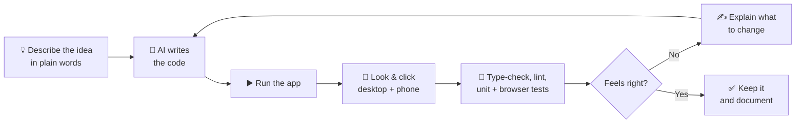
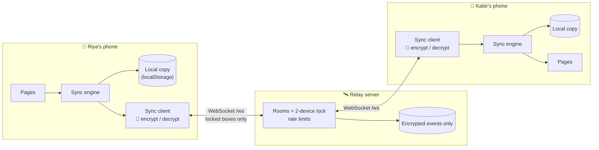

# 2 · Approaches (How We Built It, in Detail)

This page explains **how** UsSpace was made and **why** each choice was made, in simple words.

**Contents**

- [2.1 Building approach: vibe coding](#21-building-approach-vibe-coding)
- [2.2 Tech stack](#22-tech-stack)
- [2.3 Architecture](#23-architecture)
- [2.4 Security and privacy](#24-security-and-privacy)
- [2.5 Real-time sync](#25-real-time-sync)
- [2.6 Design, animation and a smooth flow](#26-design-animation-and-a-smooth-flow)
- [2.7 How each room works](#27-how-each-room-works)
- [2.8 Quality: testing and the bugs we fixed](#28-quality-testing-and-the-bugs-we-fixed)
- [2.9 What comes next](#29-what-comes-next)

---

## 2.1 Building approach: vibe coding

UsSpace was built with **vibe coding**. That means:

> We describe the *feeling* and the *idea* in plain words ("a private room for two, with a secret code, real-time chat, romantic and glowing"),
> an AI coding assistant writes the code, and a human **runs it, looks at it, tests it and asks for changes** until it feels right.

It is like working with a very fast builder: you explain the house you dream of, and you walk through every room to check it.

### Our loop

### Our rules while vibe coding

1. **Trust, but always check.** Every change is checked with `typecheck`, `lint`, unit tests, real-browser tests and a production build.
2. **Test like a real couple.** Real-time features are tested with **two browsers at once**, one creating a room and one joining it.
3. **Small, clear pieces.** Each effect, page, helper and server part lives in its own file.
4. **Words first.** Every list (love notes, prompts, moods) lives in one file ([`lib/content.ts`](../src/lib/content.ts)).
5. **The website stays about love.** The site never talks about how it was built.

---

## 2.2 Tech stack

| Tool | What it is | Why we chose it |
| --- | --- | --- |
| **React 18 + TypeScript** | Builds the screens from small parts, with types | Popular, fast, catches mistakes early |
| **Vite 5** | Starts and builds the app | Very fast; it also runs our relay during development |
| **Tailwind CSS + shadcn/ui + Radix UI** | Styling + accessible ready-made parts | Quick to design, good keyboard and screen-reader support |
| **Framer Motion** | Animation library | Page transitions, springs, scroll effects |
| **React Router** | Moves between pages without reloading | Fast, simple page links |
| **Node.js + `ws`** | A tiny WebSocket server (the "relay") | Real-time messages with almost no code and no database to manage |
| **@noble/ciphers + @noble/hashes** | Audited, pure-JavaScript cryptography | Encryption works everywhere, even on plain `http://` home networks |
| **qrcode** | Draws the QR code for the secret code | Loaded only when you press "QR" |
| **sonner, cmdk, lucide** | Toasts, quick search, icons | Small and pretty |
| **Vitest + Testing Library** | Unit, page and server tests | Same setup as Vite, very fast |
| **Playwright** | Real-browser tests on desktop and phone sizes | Checks two partners chatting for real |
| **Docker** (optional) | Packs the site + relay into one container | Easy hosting anywhere |

---

## 2.3 Architecture

UsSpace has two parts that live in the same `front-end/` folder:

1. **The website** (`src/`), a React app that runs on each phone.
2. **The relay** (`server/`), a tiny Node.js server that passes **encrypted** updates between the two phones in a room.

### Key ideas

| Idea | What it means | Where |
| --- | --- | --- |
| **Local-first** | Every phone keeps its own full copy, so pages open instantly and work offline. | [`src/sync/engine.ts`](../src/sync/engine.ts) |
| **One connection per room** | A WebSocket stays open, reconnects by itself, and catches up on anything missed. | [`src/sync/client.ts`](../src/sync/client.ts) |
| **Room provider** | Holds the room session: create, join, leave, connection status, partner presence, typing, hearts. | [`src/context/RoomProvider.tsx`](../src/context/RoomProvider.tsx) |
| **Private area guard** | Without a room, every private page redirects to **/start** (Create or Join). | [`src/components/layout/RequireRoom.tsx`](../src/components/layout/RequireRoom.tsx) |
| **Shared-data hooks** | Pages use `useSyncedList` / `useSyncedDoc` like normal state. Sharing happens by itself. | [`src/sync/hooks.ts`](../src/sync/hooks.ts) |
| **Same port for everything** | In development (`npm run dev`) and production (`npm start`), the site and the relay share one address (`/ws`). | [`vite.config.ts`](../vite.config.ts), [`server/index.mjs`](../server/index.mjs) |
| **Lazy pages** | Each room is its own small file, pre-loaded while you're idle. | [`src/App.tsx`](../src/App.tsx) |

---

## 2.4 Security and privacy

### The secret code

- Made **on your phone** from 16 random characters. That's **80 bits** of randomness, which is far too many to guess.
- It uses an easy alphabet with no `I`, `L`, `O` or `U`, so it's easy to read aloud. Typing mistakes such as `O` vs `0` are fixed automatically.
- The code itself is **never sent to the server**.

### Four keys from one code

From the code, each phone works out four different keys (using **HKDF-SHA256**):

| Key | Used for | Who sees it |
| --- | --- | --- |
| **Room id** | Tells the server *which* room | The server (it can't turn it back into the code) |
| **Auth key** | Proves you know the code when joining | Sent when joining. The server only stores its **SHA-256 hash** |
| **Encryption key** | Locks every message, plan, letter, name… (**XChaCha20-Poly1305**) | **Only your two phones** |
| **Item key** | Gives each item an anonymous label, so the server can replace old versions | The server sees random-looking labels only |

### What the server can and can't see

| ✅ The server **can** see | ❌ The server can **never** see |
| --- | --- |
| A random room id and two random device ids | Your secret code |
| When a message is sent, and roughly how big it is | Your messages, photos, names, moods, letters, plans, songs, scores |
| Your IP address (needed to talk to you) | Which page you're on, or what kind of item something is |

### Locks and limits

| Protection | How it works |
| --- | --- |
| **2-device lock** | A room accepts exactly two devices. A third device gets "This room already has two people", even with the right code. |
| **Wrong-code lockout** | 10 wrong tries on a room within 15 minutes locks it for joining for a while. |
| **Guessing limit per IP** | Wrong codes and new rooms use up "tries" (15, then 1 every 5 seconds). Correct reconnects are always free. |
| **Message limits** | Max size per event (≈750 KB), max messages per second, max windows per room. |
| **Must sign in fast** | A connection that doesn't create or join a room within 10 seconds is closed. |
| **Tamper-proof** | Encrypted data that has been changed fails to open and is ignored. |
| **Website security headers** | A strict Content-Security-Policy, no framing, no-sniff, no referrer, and HSTS behind HTTPS. |
| **Leave room** | Removes this device from the room and deletes its local copy. The seat becomes free again. |

### Honest limits (good to know)

- **Time-locked letters** are hidden until their day, but the letter is already on your partner's phone (encrypted in transit, readable on the device). It's a promise, not a bank vault.
- Anyone who can unlock **your phone** can open UsSpace on it. Lock your phone.
- The QR / invite link puts the code after a `#`, which never reaches any server. But **whoever you send it to** can read it, so send it only to your partner.
- Rooms that nobody opens for 180 days are deleted from the server. Your own device still has its copy, and if the server ever loses a room, the app **rebuilds it automatically** from that copy.

---

## 2.5 Real-time sync

Everything you share is stored as small **items** (one message, one plan, your profile, the music player…). Every change is a **"put"**: the newest version of one item.

| Rule | Why |
| --- | --- |
| **Newest wins.** Each put carries a time (from the server's clock) and a device id. | Both phones end up exactly the same, whatever order changes arrive in. |
| **Deletes are remembered** ("tombstones", kept 60 days). | An old copy can't bring a deleted item back. |
| **Written in the author's words.** "My message" (`sender: "me"`) becomes "their message" on the partner's phone. | Every page can simply say "me" and "partner". |
| **Optimistic.** Your change shows instantly and waits in an **outbox** (saved, even across reloads) until the server confirms. | Fast, and nothing is lost if the internet drops. |
| **Catch-up.** Every event gets a number. On reconnect, a phone asks for "everything after number N". | Messages sent while you were offline arrive when you come back. |
| **Compaction.** The server keeps only the newest version of each item. | Storage stays small. |
| **Clock sync.** Each phone learns the server time on connect. | Message order and the shared music timeline line up across phones. |
| **Self-healing.** If the server lost the room, the first phone to reconnect re-creates it and re-uploads its copy. | Rooms survive server resets. |
| **Signals.** Typing, hearts and nudges are sent live but **not stored**. | Light and instant. |

Reads come straight from memory (`useSyncExternalStore`), and the copy on the device is saved in small batches, so typing and scrolling stay smooth.

---

## 2.6 Design, animation and a smooth flow

The full design guide is in [3 · Design](03-design.md). The key ideas:

1. **Design tokens first.** Every colour, radius and gradient is a CSS variable in [`index.css`](../src/index.css).
2. **Glass on a night sky,** with a rose → violet gradient for everything important.
3. **Motion with meaning:** a new message pops in, a won game glows, a countdown digit rolls.
4. **Light on the battery:** background particles are pure CSS, and timers tick in tiny components only.
5. **Respect for "reduce motion"** everywhere.
6. **Inspired by 50+ modern template patterns**, re-built by hand.

### Smooth-flow features

| Feature | What the user feels |
| --- | --- |
| **Create → share → enter** | One form, then a big code with **Copy / Share / QR**, and a live "Waiting for your partner…" that turns into "Kabir joined! 💞". |
| **Join by link or QR** | Scanning the QR opens the Join form with the code already filled in. |
| **Friendly errors** | "We couldn't find a room with that code", "This room already has two people", "Too many tries, wait a minute". |
| **Connection pill** | The top bar shows *Kabir is here*, *Live*, *Waiting for partner*, *Connecting…* or *Offline · changes saved*. |
| **Partner notifications** | "💬 Kabir: …", "💌 Kabir wrote you a letter", "📅 Kabir added a plan", each with a button to jump there. |
| **Page transitions + scroll reset** | No hard jumps between pages. |
| **Phone dock + More menu** | Every room is reachable on a phone. |
| **Quick search** | `Ctrl + K` / `⌘ + K` jumps to any page or action. |
| **Undo** | Deleting a plan, song, letter or memory can be undone. |
| **Keyboard** | `Enter` sends, `Shift + Enter` adds a new line, `Space` plays/pauses music, `Ctrl + B` toggles the sidebar. |

---

## 2.7 How each room works

| Room | How it works (simple) |
| --- | --- |
| **Start** | *Create*: your name + "together since" → a secret code is made on your phone → the room is created → you get Copy / Share / QR. *Join*: the code + your name → checked → you're in, and the room locks. |
| **Home** | Days together, a ring counting down to your anniversary (the first one is one full year after the start date), your mood, the love note of the day, and live cards for every room. Shows "Invite your partner" until they join. |
| **Chat** | Messages appear instantly on both phones. "typing…" shows while your partner types. Ticks: 🕓 sending → ✓ sent → ✓✓ seen (seen = your partner had the chat open). Photos are shrunk to 720 px. Long chats draw the newest 80 messages first, with "Show earlier". "Clear chat" clears it for both of you, after a warning. |
| **Presence** | Online / last seen comes from the live connection. Your status, mood and "show me as online" are shared. The big heart sends a **nudge** that pops up on your partner's phone. |
| **Games** | *Tic-Tac-Toe*: you're ❤️ and your partner is 💜, each person moves on their own phone, turns are enforced, and both phones celebrate a win. Before your partner joins, you can pass one phone around. *Truth or Dare*: the card you draw flips on both screens. *Memory Match* and *Would You Rather* are played on one phone. |
| **Planner** | Shared plans, a live countdown to the next one, and a calendar with dots. |
| **Music** | One shared timeline: *song, playing?, position at time T*. Both phones work out "where are we now?" from the server clock, so play, pause, seek and skip happen on both. "Listen" opens the song itself. |
| **Letters** | Sealed until their day (their words aren't even drawn on screen). When your partner opens a letter you wrote, you see "Read by Kabir ✓". |
| **Timeline** | Shared memories, sorted by date, with a glowing line that draws itself as you scroll. |

---

## 2.8 Quality: testing and the bugs we fixed

### Checks we run (inside `front-end/`)

| Command | What it checks | Result |
| --- | --- | --- |
| `npm run typecheck` | No type errors | ✅ passes |
| `npm run lint` | Code style and React rules (app + server) | ✅ 0 errors (7 standard warnings inside generated `ui/` files) |
| `npm test` | **79 tests**: encryption, sync engine, relay server, dates, games, storage, every page, routing | ✅ all pass |
| `npm run test:e2e` | **10 real-browser tests** (5 tests × desktop + phone), including **two browsers chatting live**, a wrong code and a full room | ✅ all pass |
| `npm run build` | Production build | ✅ builds, and each room is its own small file |
| `npm start` | Production server | ✅ health check, page routing, security headers, gzip, `../` path blocked, WebSocket rooms |

We also opened every page with **two real devices at once** (a 1440 px desktop and a 390 px phone) on the production server. There were no console errors and no security-policy problems, and nothing was cut off at 360 px.

### Tests we wrote

- [`crypto.test.ts`](../src/test/crypto.test.ts): code format and randomness, typo fixes, key derivation, encryption round-trip, tamper detection, wrong-room rejection.
- [`engine.test.ts`](../src/test/engine.test.ts): newest-wins, tie-breaks, tombstones, me/partner swap, clock skew, re-upload snapshot.
- [`relay.test.ts`](../src/test/relay.test.ts): create, unknown code, wrong auth, partner joins, live events and signals, 2-device lock, catch-up + compaction, leave frees the seat, bad input, guessing lockout.
- [`pages.test.tsx`](../src/test/pages.test.tsx): every page in a room, the join-code form, sending while offline (🕓), a partner's message arriving live, and two-player tic-tac-toe turns.
- [`routing.test.tsx`](../src/test/routing.test.tsx): private pages are locked without a room, the layout, 404 and redirects.
- [`time.test.ts`](../src/test/time.test.ts), [`games.test.ts`](../src/test/games.test.ts), [`storage.test.tsx`](../src/test/storage.test.tsx): dates, game rules, saving.
- [`e2e/smoke.spec.ts`](../e2e/smoke.spec.ts): two browsers create and join, chat live with typing and seen ticks, wrong code and full room, every room opens.

### Bugs found and fixed

**First round (redesign)**

| # | Bug (before) | Fix (now) |
| --- | --- | --- |
| 1 | Unknown links showed an **empty page**. | Catch-all route with a friendly 404. |
| 2 | Planner countdown was stuck on **"Today! 🎉" forever** (dates hard-coded to 2025). | Real countdown to the real next plan. |
| 3 | Dates were read as **UTC**, which shows the **wrong day** in many time zones. | `parseLocalDate()` reads local time. |
| 4 | Letters were **always locked**, even after their date. | The lock is worked out from the unlock day. |
| 5 | Sealed letters still had their **secret text in the page** (just blurred). | Sealed letters don't include their words at all. |
| 6 | On phones, **Music, Letters, Timeline and Home could not be reached**. | Floating dock + **More** menu. |
| 7 | The phone "Home" button **left the app**. | Opens the dashboard. |
| 8 | No link to the dashboard in the sidebar. | "Home" + grouped sections. |
| 9 | A **button inside a link** on the landing page. | One proper link. |
| 10 | Tic-Tac-Toe had **no winner check**. | Winner, draw, glowing line, locked board, scores. |
| 11 | Chat **typing dots always visible**. | Shown only while your partner types. |
| 12 | Chat **didn't scroll** to new messages. | Smooth auto-scroll (not while you read older ones). |
| 13 | Chat **photo and emoji buttons did nothing**. | Photo sending + emoji picker. |
| 14 | Enter with an **IME keyboard** sent half a word. | Ignored while composing. |
| 15 | **Everything was lost on refresh.** | Saved on the device + synced. |
| 16 | Music **progress never moved**, skip did nothing, and the record **snapped back**. | Real shared timeline. |
| 17 | Letters and Planner **"+" buttons did nothing**. | Working forms. |
| 18 | The 404 link **reloaded the whole app**. | Router links. |
| 19 | Title was **"Lovable App"**, with the builder's branding. | UsSpace branding everywhere. |
| 20 | `playwright.config.ts` imported a **missing package**. | Standard config. |
| 21 | **Two package managers** + a builder-only plugin. | npm only. |
| 22 | Unused `App.css` template styles. | Removed. |
| 23 | Toasts turned **white on light-mode computers**. | Always dark glass. |
| 24 | Two lint errors in UI files. | Fixed. |
| 25 | Fonts loaded with a slow CSS `@import`. | `preconnect` + `<link>`. |
| 26 | Particles ignored **reduce motion**. | Respected. |

**Second round (rooms + real time)**

| # | Bug or weak spot (before) | Fix (now) |
| --- | --- | --- |
| 27 | **Anyone could open the app**: no rooms, no pairing, no partner. | Create / Join with a secret code, 2-device lock, end-to-end encryption. |
| 28 | Chat replies were **fake demo answers**. | Real messages from your real partner, live. |
| 29 | "Seen" ticks were **always shown**, even before sending. | Real states: 🕓 sending → ✓ sent → ✓✓ seen. |
| 30 | The tick icons' labels were **hidden from screen readers**. | Proper accessible labels. |
| 31 | A brand-new couple saw **"Happy anniversary!" on day one**. | The first anniversary is one full year after the start date. |
| 32 | The server's guessing limit also counted **correct reconnects**, so a couple on the same Wi-Fi could get locked out. | Only wrong codes and new rooms use up tries. |
| 33 | A temporary "too many tries" on reconnect could **kick you out of your room**. | The app waits and retries quietly. |
| 34 | Tic-Tac-Toe squares were all named "played here". | "Square 5, Kabir": clear for screen readers. |
| 35 | The Planner and Memory Match **re-drew the whole page every second**. | Only the tiny clock re-draws. |
| 36 | Background particles used JavaScript animation on every frame. | Pure CSS, so almost no battery use. |
| 37 | Long chats drew **every** message. | Newest 80 first, with "Show earlier", and memoised bubbles. |
| 38 | An unused data library (`react-query`) shipped in the app. | Removed. |

---

## 2.9 What comes next

| Step | Idea |
| --- | --- |
| 1. **Install as an app (PWA)** | Home-screen icon, offline start, and **push notifications** ("💌 A letter just unlocked"). |
| 2. **Bigger media** | Photos and voice notes stored encrypted in IndexedDB / cloud storage instead of `localStorage`. |
| 3. **App lock** | Optional PIN or fingerprint before UsSpace opens on a phone. |
| 4. **More than one device each** | e.g. phone + laptop, with a safe "approve new device" step. |
| 5. **Real music sync** | Connect Spotify / YouTube so the actual audio plays in sync. |
| 6. **Light theme** | A soft "morning" theme using the same tokens. |

Because pages only talk to the sync hooks, and the server only sees locked boxes, these can be added without rewriting the rooms.

**Back:** [← 1 · Problem & Solution](01-problem-and-solution.md) · **Next:** [3 · Design →](03-design.md)
