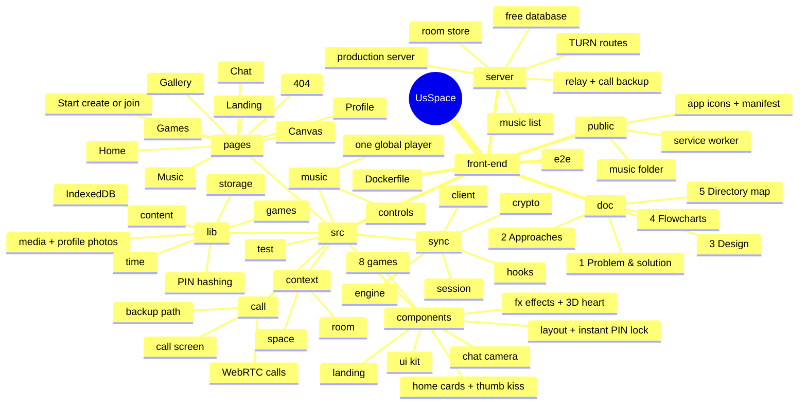
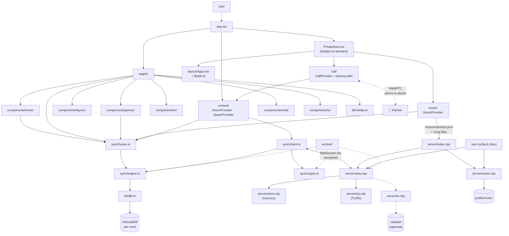

# 5 · Directory Map (Every Folder, Explained with Pictures)

This page is a **map of the whole project**. It shows every folder, what lives in it, and how the parts talk to each other.

**Contents**

- [5.1 The project at a glance](#51-the-project-at-a-glance)
- [5.2 Mind map](#52-mind-map)
- [5.3 Full folder tree](#53-full-folder-tree)
- [5.4 How the folders depend on each other](#54-how-the-folders-depend-on-each-other)
- [5.5 Folder by folder](#55-folder-by-folder)
- [5.6 Which file do I open to…?](#56-which-file-do-i-open-to)
- [5.7 Generated folders (not saved in the project)](#57-generated-folders-not-saved-in-the-project)

---

## 5.1 The project at a glance

```
usspace-your-private-haven/
├── 📄 README.md          ← start here
└── 🖥️ front-end/         ← everything: the website AND its small real-time server
    ├── 📚 doc/           ← the 5 guides (you are reading one)
    ├── ✨ src/           ← the website (React)
    ├── 🛰️ server/        ← the relay + production server (Node.js)
    ├── 🎵 public/music/  ← YOUR songs (played in sync on both phones)
    └── 🧪 e2e/           ← real-browser tests (two browsers, real video call)
```

| Folder | In one line |
| --- | --- |
| `front-end/src/` | Everything you see and use in the browser, plus encryption, live sync, calls and music |
| `front-end/server/` | The tiny relay that passes encrypted updates between the two phones, and the production web server |
| `front-end/public/music/` | Drop your downloaded songs here. They appear in the Music room automatically |
| `front-end/doc/` | Easy-English guides: problem, approaches, design, flowcharts, this map |
| `front-end/e2e/` | Playwright tests that use two real browsers |

---

## 5.2 Mind map



---

## 5.3 Full folder tree

```
usspace-your-private-haven/
│
├── README.md                         Main guide for the whole project
│
└── front-end/                        🖥️ The website + its relay server
    ├── doc/                          📚 Five easy-English guides
    │   ├── 01-problem-and-solution.md    What problem, what website, which users
    │   ├── 02-approaches.md              How it was built, security, sync, calls, the database, bugs fixed
    │   ├── 03-design.md                  Fonts, colours, motion, 3D, 82 template patterns
    │   ├── 04-flowcharts.md              Diagrams of every flow
    │   ├── 05-directory-map.md           This map
    │   ├── BUILD-PROMPT.md               One detailed prompt to rebuild the whole website with a coding agent
    │   └── screenshots/                  Pictures used in the README
    │
    ├── index.html                    The one HTML page: title, meta tags, fonts
    ├── package.json                  Scripts (dev, build, start, test, test:e2e…) and libraries
    ├── package-lock.json             Exact library versions (npm)
    ├── vite.config.ts                Dev server (port 8080): relay on /ws + music list
    ├── vitest.config.ts              Unit-test settings
    ├── playwright.config.ts          Browser-test settings (desktop + phone, fake camera)
    ├── playwright-fixture.ts         Shared Playwright helpers
    ├── tailwind.config.ts            Fonts, colours, keyframe animations (incl. 3D spin)
    ├── postcss.config.js             Runs Tailwind + Autoprefixer
    ├── eslint.config.js              Code-style rules (app + server)
    ├── tsconfig*.json                TypeScript settings
    ├── components.json               shadcn/ui settings
    ├── Dockerfile                    Build + run the site and relay in one container
    ├── .dockerignore                 Files Docker should skip
    ├── .env.example                  Optional server settings: TURN for calls, the free database, proxy
    ├── .gitignore                    Files git should skip
    ├── README.md                     Short front-end guide
    │
    ├── server/                       🛰️ Plain Node.js, no build step
    │   ├── relay.mjs                 Rooms, 2-device lock, auth check, rate limits, live events, close room,
    │   │                             call routes, call backup frames
    │   ├── store.mjs                 Encrypted events per room, in memory, forgotten once both phones have them
    │   ├── ice.mjs                   Call routes: free STUN + optional TURN (Cloudflare or any TURN service)
    │   ├── kv.mjs                    Optional free database (Upstash): closed rooms + each room's 2 devices
    │   ├── music.mjs                 Lists the songs in the music folder
    │   ├── index.mjs                 Production server: dist/ + /ws + music + security headers + gzip
    │   └── *.d.mts                   Type hints for the server files
    │
    ├── public/                       Files served as they are
    │   ├── music/                    🎵 YOUR songs (61 right now) + PUT-YOUR-SONGS-HERE.txt
    │   ├── favicon.svg               Heart logo
    │   ├── icon-192.png, icon-512.png, icon-maskable-512.png, apple-touch-icon.png   App icons
    │   ├── manifest.webmanifest      "Add to Home Screen" (name, colours, icons)
    │   ├── sw.js                     Service worker: notifications only, caches nothing
    │   ├── call-audio-worklet.js     Call audio for the backup path (microphone → 16 kHz → speaker)
    │   ├── placeholder.svg           Spare image
    │   └── robots.txt                Rules for search engines
    │
    ├── e2e/
    │   └── smoke.spec.ts             Two browsers: create, join, live chat, wrong code, full room, every room
    │                                 opens, profile photo + question of the day + thumb kiss + instant PIN lock,
    │                                 game invite, video call direct, call through the server,
    │                                 automatic switch when no direct line works
    │
    └── src/                          ✨ The app
        ├── main.tsx                  Starts React + registers the service worker
        ├── App.tsx                   Providers, routes, lazy pages + quiet pre-loading
        ├── PrivateArea.tsx           Everything behind the code: room guard, PIN lock, calls, music, layout
        ├── index.css                 Design tokens + glass, gradient, beam effects, privacy blur
        ├── vite-env.d.ts             Type hints for Vite
        │
        ├── pages/                    One file per screen
        │   ├── Index.tsx             Landing page
        │   ├── Start.tsx             Create a room · Join a room · Secret code + QR
        │   ├── Dashboard.tsx         Home: photos, days + milestones, 4 big buttons, question, countdown,
        │   │                         notes, mood, love note, room cards
        │   ├── Chat.tsx              Live chat: typing, ticks, photos, videos, camera, reactions, calls, "Latest"
        │   ├── Gallery.tsx           Shared photos, full-screen viewer, "Show Kabir", voice chat
        │   ├── Canvas.tsx            Draw together on a board that grows: pen, neon, stickers, photos, scroll, PNG
        │   ├── Games.tsx             8 games: invite → partner joins → play
        │   ├── MusicPlayer.tsx       Vinyl, shared controls, searchable playlist
        │   ├── Profile.tsx           Photo, name, together since, code + share, PIN, notifications, log out,
        │   │                         close room
        │   └── NotFound.tsx          Friendly 404
        │
        ├── sync/                     🔐 Encryption + live sync
        │   ├── crypto.ts             Secret codes, key derivation, encrypt / decrypt
        │   ├── engine.ts             Shared data: newest wins, deletes, me ↔ partner, all-or-nothing saving
        │   ├── client.ts             WebSocket: reconnect, paced outbox, catch-up, epochs, "seen" receipts,
        │   │                         signals, call frames + routes, close
        │   ├── hooks.ts              useSyncedList / useSyncedDoc / usePendingIds / useEngine
        │   └── session.ts            Which room this phone is in
        │
        ├── call/                     📞 Voice and video calls
        │   ├── call.ts               useCall() + call state shape + fallback routes
        │   ├── CallProvider.tsx      Ring, accept, offer / answer, live routes, line repair, switch to the
        │   │                         backup path, mute, camera, flip, ringtone, notifications
        │   ├── relay-media.ts        The backup path: μ-law voice + JPEG pictures, sealed with the room key
        │   └── CallOverlay.tsx       Ringing screen, full-screen call, floating call bar, "Tap to hear"
        │
        ├── music/                    🎵 One music player for the whole app
        │   ├── music.ts              useMusic() + what the player can do
        │   ├── MusicProvider.tsx     Song list, shared timeline, audio element, lock-screen controls
        │   └── MusicControls.tsx     Progress bar, buttons, volume, the 🎵 top-bar pop-up
        │
        ├── context/                  🌐 Shared React state
        │   ├── room.ts               useRoom() + friendly room errors
        │   ├── RoomProvider.tsx      Create, join, leave, close, status, presence, signals, pop-ups
        │   ├── space.ts              useSpace()
        │   └── SpaceProvider.tsx     Me + partner + couple → one easy profile (names, photos, date),
        │                             plus which dialogs are open (log out, thumb kiss, search)
        │
        ├── components/
        │   ├── fx/                   ✨ Animated effects (14 files, incl. Heart3D)
        │   ├── home/                 🏠 QuestionCard, MeetCard (countdown), NoteCard, ThumbKiss
        │   ├── layout/               🧱 App frame (13 files, incl. AppLock, LogoutDialog, RequireRoom)
        │   ├── chat/                 📷 CameraCapture (photos + videos up to 2 minutes)
        │   ├── games/                🎮 The 8 two-player games + new-game.ts (fresh game states)
        │   ├── landing/              🌌 Mini demos for landing cards
        │   └── ui/                   🧩 shadcn/ui base parts (49 files)
        │
        ├── hooks/
        │   ├── use-miss-you.ts       💖 "I'm missing you" (live or as a chat message)
        │   ├── use-now.ts            Current time that refreshes
        │   ├── use-mobile.tsx        Is this a phone-size screen?
        │   └── use-toast.ts          shadcn toast helper
        │
        ├── lib/                      🧠 Plain logic
        │   ├── idb.ts                Small IndexedDB helper (big storage for photos and videos)
        │   ├── media.ts              Shrink photos, profile photos (320 px square), read videos (max 2 min /
        │   │                         8 MB), best video format
        │   ├── pin.ts                PIN hashing (PBKDF2), wrong-try counter, useAppLock()
        │   ├── notify.ts             Phone notifications while the app is in the background
        │   ├── storage.ts            Per-room local storage + usePersistentState
        │   ├── time.ts               Local dates, countdowns, anniversaries, milestones, UTC day number
        │   ├── games.ts              Winner checks (3 and 4 in a row), rock-paper-scissors, shuffles, shared order
        │   ├── content.ts            All words: love notes, prompts, quiz questions, moods, game names,
        │   │                         50 questions of the day
        │   ├── seed.ts               Starting values (names, player, boards)
        │   ├── types.ts              Shapes of shared data
        │   ├── nav.ts                Menu items, phone dock, the Profile page entry
        │   ├── burst.ts              Heart-burst event bus
        │   ├── motion.ts             Shared animation timings
        │   └── utils.ts              cn() class helper
        │
        └── test/                     🧪 99 Vitest tests
            ├── setup.ts              Browser mocks (incl. an offline WebSocket, silent audio + canvas)
            ├── crypto.test.ts        Codes, keys, encryption (12)
            ├── engine.test.ts        Newest-wins, deletes, me ↔ partner, all-or-nothing saving (11)
            ├── relay.test.ts         The real relay server: close room, forgetting, epochs, resync, call
            │                         frames, TURN, the database across restarts, memory cap (18)
            ├── pages.test.tsx        Every page inside a room, game invites, Connect Four, the growing canvas,
            │                         question of the day, Profile, instant PIN lock (18)
            ├── routing.test.tsx      Room guard, layout, 404 (5)
            ├── time.test.ts          Dates and anniversaries (17)
            ├── games.test.ts         All game rules + call voice encoding (12)
            └── storage.test.tsx      Per-room storage (6)
```

---

## 5.4 How the folders depend on each other

Arrows mean "uses". Pages sit at the top. The phones talk to the server only through `sync/client.ts`, and to each other directly only for calls.



---

## 5.5 Folder by folder

### `front-end/server/`: the relay and production server

| File | Job |
| --- | --- |
| `relay.mjs` | Accepts WebSocket connections on `/ws`. Handles **create**, **join** (auth hash check, 2-device lock, epochs), **put** (store + forward), **seen** (forget what both phones have), **signal** (forward only: typing, hearts, call set-up), **ice** (call routes for room members), binary **call frames** (forward only, never stored), **leave**, and **close** (delete the room, tell both phones, never let it come back). Rate limits, lockout after wrong codes, heartbeats. |
| `store.mjs` | Keeps each room's **encrypted** events until both phones have saved them, only the newest per item, max 80 MB per room and 320 MB in total. **Memory only** by default. With `USSPACE_DATA_DIR` it also saves to disk. |
| `ice.mjs` | Hands out call routes: free STUN, plus TURN from Cloudflare (`CLOUDFLARE_TURN_*`, credentials cached for 12 hours) or any TURN service (`TURN_URLS`…). |
| `kv.mjs` | The optional free database (Upstash Redis, REST API). Stores only "closed" records and each room's two device ids. |
| `music.mjs` | Reads the music folder and returns `{ songs: [{ id, url, title }] }`, sorted A–Z. The title is the file name without `.mp3` (underscores become spaces). |
| `index.mjs` | Production: serves `dist/` with a strict Content-Security-Policy and other security headers, Brotli or gzip (kept in memory after the first time), long-term caching, **partial (Range) answers for music**, `/music/manifest.json`, a `/healthz` check, plus the relay. |

### `front-end/src/sync/`: encryption and live sync

| File | Main exports |
| --- | --- |
| `crypto.ts` | `generateCode`, `formatCode`, `normalizeCode`, `isValidCode`, `deriveKeys`, `seal`, `open`, `sealBytes`, `openBytes`, `itemKey`, `randomId` |
| `engine.ts` | `SyncEngine` (`put`, `receive`, `get`, `subscribe`, `snapshot`, `getLocal`, `setLocal`, `wipe`), `COLUMNS`, `swap`, `openPersistence` |
| `client.ts` | `SyncClient` (connect, reconnect, paced outbox, catch-up, epochs, seen receipts, `sendSignal`, `sendMedia`, `iceServers`, `closeRoom`), `relayUrl` |
| `hooks.ts` | `useSyncedList`, `useSyncedDoc`, `usePendingIds`, `useEngine` |
| `session.ts` | `loadSession`, `saveSession`, `clearSession` |

**Shared columns** (in `engine.ts`): `messages`, `photos`, `strokes`, `stickers` (lists) · `member`, `read`, `couple`, `player`, `game`, `gview`, `ttt`, `tod`, `memory`, `wyr`, `c4`, `rps`, `nhie`, `quiz`, `scores` (single items).

### `front-end/src/pages/`: the screens

| File | Route | What you see |
| --- | --- | --- |
| `Index.tsx` | `/` | Hero, highlights, feature bento, 3 steps, FAQ, final CTA |
| `Start.tsx` | `/start` | Create / Join cards → forms → secret code with Copy / Share / QR → "partner joined" |
| `Dashboard.tsx` | `/dashboard` | Invite card (until your partner joins), both photos, days together, years, anniversary and next milestone (hearts on the day), 3D heart, Missing you / Thumb kiss / Video / Voice buttons, question of the day, countdown, notes, mood, love note, live room cards |
| `Chat.tsx` | `/chat` | Header with online / typing / last seen and call buttons, messages with ticks, photos, videos, camera, emoji; opens at the newest message |
| `Gallery.tsx` | `/gallery` | Upload many photos, masonry grid, viewer, "Show Kabir", voice chat |
| `Canvas.tsx` | `/canvas` | Sticky toolbar (pen, neon, eraser, stickers, scroll, colours, sizes, photo), a shared board that grows |
| `Games.tsx` | `/games` | 8 game cards with Invite → waiting → playing → End game |
| `MusicPlayer.tsx` | `/music` | Vinyl, shared controls, volume, searchable playlist, "Add your songs" help |
| `Profile.tsx` | `/profile` | Banner + photo (add / change / remove), name and together-since form, stats, secret code (reveal, copy, share link), PIN lock (set, change, off, lock now), notifications, Log out, Close room |
| `NotFound.tsx` | anything else | Broken-heart 404 |

### `front-end/src/call/` and `front-end/src/music/`

| File | Job |
| --- | --- |
| `call/CallProvider.tsx` | Every call message travels as an encrypted room signal: ring → accept → offer → answer → routes (or decline / busy / end / relay). Gets routes from the server, repairs a dropped line, switches to the backup path after 15 s without a direct line, handles calling at the same time, ring timeout (45 s), ringtone, vibration and notifications. |
| `call/relay-media.ts` | The backup path: microphone → 16 kHz μ-law (via `public/call-audio-worklet.js`), camera → small JPEG pictures, each sealed with the room key and passed through the server. |
| `call/CallOverlay.tsx` | The ringing screen, the full-screen call (big partner video, small self view, or the avatar in the middle for voice), "Connected through UsSpace", "Tap to hear", and the floating mini bar. |
| `music/MusicProvider.tsx` | Loads the song list, keeps **one** audio element for the whole app, follows the shared timeline, and connects lock-screen / headphone buttons. |
| `music/MusicControls.tsx` | `MusicProgress`, `MusicButtons`, `MusicVolume` and `TopbarMusic` (the 🎵 pop-up). |

### `front-end/src/components/layout/`: the app frame

| File | Job |
| --- | --- |
| `AppLayout.tsx` | Puts everything together: quick page fades (the new page shows at once), scroll reset, log-out dialog, thumb kiss |
| `RequireRoom.tsx` | No room → `/start`. Also shows a dialog if the room can't be used anymore |
| `AppLock.tsx` | `AppLock` locks the instant the page is hidden (not for the app's own photo picker), keeps the app running but `inert` behind the lock; `PinPad` keypad (also used in Profile); `LockScreen` with your photo, wait timer and "Forgot PIN?" |
| `ConnectionPill.tsx` | "Kabir is here" / "Live" / "Waiting for partner" / "Connecting…" / "Offline · changes saved" |
| `AppSidebar.tsx` | Desktop sidebar (and the phone "More" menu), with a profile card (both photos, days together, anniversary bar) and a Log out button |
| `Topbar.tsx` | Page title, connection pill, search, 🎵 music, 💖 missing you, and the account menu on your photo (Profile, Lock now, Log out) |
| `MobileNav.tsx` | Floating bottom dock |
| `CommandMenu.tsx` | `Ctrl + K` quick search and actions (incl. thumb kiss, Profile, Lock now, Log out) |
| `LogoutDialog.tsx` | "Log out of this phone?" with a copy-your-code reminder |
| `InitialAvatar.tsx` | `InitialAvatar` (photo or first letter, sizes xs → 2xl, online dot) and `UserAvatar` ("me" or "partner") |
| `PageHeader.tsx`, `EmptyState.tsx`, `PageLoader.tsx` | Small shared pieces |

### `front-end/src/components/fx/`, `home/`, `chat/`, `games/`, `landing/`, `ui/`

- **fx/**: `Heart3D`, `AuroraBackground`, `FloatingParticles` (pure CSS), `SpotlightCard`, `NumberTicker`, `SlotNumber`, `WordReveal`, `Marquee`, `Meteors`, `OrbitingIcons`, `ProgressRing`, `Equalizer`, `Reveal`, `BurstLayer`.
- **home/**: `QuestionCard` (question of the day, past answers), `MeetCard` (next time together countdown), `NoteCard` (notes for each other), `ThumbKiss` (full-screen touch pad, live signals, invite pop-up).
- **chat/**: `CameraCapture` (live preview, photo / video, clips up to 2 minutes, flip camera).
- **games/**: `TicTacToe`, `ConnectFour`, `CoupleQuiz`, `RockPaperScissors`, `NeverHaveIEver`, `TruthOrDare`, `MemoryMatch`, `WouldYouRather`, all shared and two-player, + `new-game.ts`.
- **landing/**: `FeatureDemos`.
- **ui/**: 49 shadcn/ui parts. We changed `button` (gradient and glass styles), `slider` (brand colours), `sonner` (always dark), `command` and `sidebar` (screen-reader titles), and `textarea` (lint fix).

---

## 5.6 Which file do I open to…?

| I want to… | Open |
| --- | --- |
| **Add or remove songs** | Put files in `front-end/public/music/` (then restart `npm run dev`, or redeploy) |
| Change words, love notes or game prompts | `front-end/src/lib/content.ts` |
| Change colours or the glass style | `front-end/src/index.css` |
| Change fonts or animation speeds | `front-end/tailwind.config.ts` + `front-end/index.html` |
| Change canvas colours or stickers | `front-end/src/pages/Canvas.tsx` (`COLORS`, `STICKERS`) |
| Change video length or size limits | `src/lib/media.ts` (`MAX_VIDEO_SECONDS`, `MAX_VIDEO_BYTES`) + `server/relay.mjs` (`maxPayload`) |
| Best call quality on strict networks | Set `CLOUDFLARE_TURN_KEY_ID` + `CLOUDFLARE_TURN_API_TOKEN` on the server (see `.env.example`) |
| Make "Close room" survive restarts | Set `UPSTASH_REDIS_REST_URL` + `UPSTASH_REDIS_REST_TOKEN` on the server |
| Add a game | A component in `src/components/games/`, a fresh state in `new-game.ts`, a column in `src/sync/engine.ts`, a card in `src/pages/Games.tsx`, a name in `GAME_NAMES` |
| Change the PIN lock (when it locks, tries, wait) | `src/components/layout/AppLock.tsx` + `src/lib/pin.ts` (`MAX_TRIES`, `WAIT_MS`) |
| Add or change the questions of the day | `front-end/src/lib/content.ts` (`DAILY_QUESTIONS`) |
| Change milestones | `front-end/src/lib/time.ts` (`MILESTONES`) |
| Change the profile photo size | `front-end/src/lib/media.ts` (`avatarFromFile`) |
| Add a new shared feature | Add a column in `src/sync/engine.ts` (`COLUMNS`), then use `useSyncedList` / `useSyncedDoc` |
| Add a new room (page) | `src/pages/MyRoom.tsx` + a route in `src/App.tsx` + a menu item in `src/lib/nav.ts` |
| Change rate limits, message size or memory caps | `front-end/server/relay.mjs` (`LIMITS`) and `server/store.mjs` (`STORE_LIMITS`) |
| Change security headers | `front-end/server/index.mjs` |
| Host the relay somewhere else | Set `VITE_SYNC_URL` (see `.env.example`) |
| Add a test | `front-end/src/test/` (unit) or `front-end/e2e/` (browser) |

---

## 5.7 Generated folders (not saved in the project)

| Folder | Made by | Safe to delete? |
| --- | --- | --- |
| `front-end/node_modules/` | `npm install` | Yes, run `npm install` again |
| `front-end/dist/` | `npm run build` (includes a copy of the music folder) | Yes, run the build again |
| `USSPACE_DATA_DIR` folder | The relay, **only if you set it** | ⚠️ Deleting it removes rooms from the server. Phones still keep their copy and re-create the room on their next connection |
| `front-end/test-results/`, `playwright-report/` | `npm run test:e2e` | Yes |

**Back:** [← 4 · Flowcharts](04-flowcharts.md) · **Home:** [README](../../README.md)
