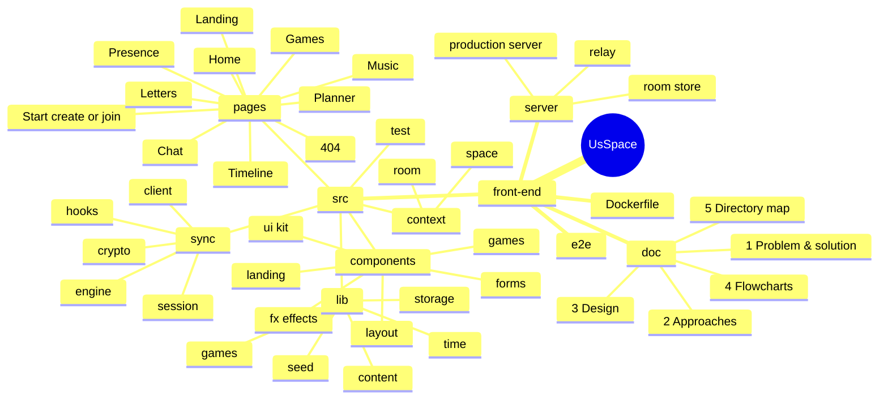
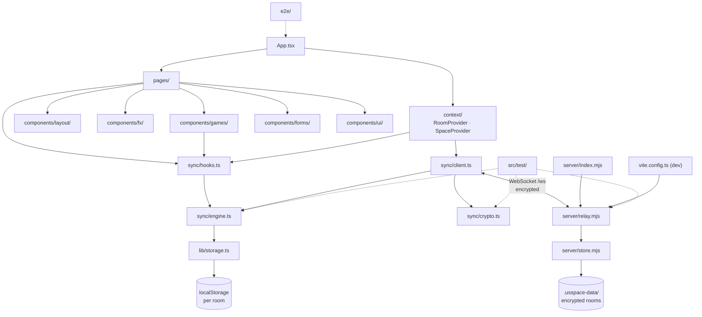

# 5 · Directory Map (Every Folder, Explained with Pictures)

This page is a **map of the whole project**. It shows every folder, what lives in it, and how the parts talk to each other.

**Contents**

- [5.1 The project at a glance](#51-the-project-at-a-glance)
- [5.2 Mind map](#52-mind-map)
- [5.3 Full folder tree](#53-full-folder-tree)
- [5.4 How the folders depend on each other](#54-how-the-folders-depend-on-each-other)
- [5.5 Folder by folder](#55-folder-by-folder)
- [5.6 Which file do I open to…?](#56-which-file-do-i-open-to)
- [5.7 Generated folders (not saved in the project)](#57-generated-folders-not-saved-in-the-project)

---

## 5.1 The project at a glance

```
usspace-your-private-haven/
├── 📄 README.md          ← start here
└── 🖥️ front-end/         ← everything: the website AND its small real-time server
    ├── 📚 doc/           ← the 5 guides (you are reading one)
    ├── ✨ src/           ← the website (React)
    ├── 🛰️ server/        ← the relay server (Node.js, WebSocket)
    └── 🧪 e2e/           ← real-browser tests
```

| Folder | In one line |
| --- | --- |
| `front-end/src/` | Everything you see and use in the browser, plus encryption and live sync |
| `front-end/server/` | The tiny relay that passes encrypted updates between the two phones in a room |
| `front-end/doc/` | Easy-English guides: problem, approaches, design, flowcharts, this map |
| `front-end/e2e/` | Playwright tests that use two real browsers |

---

## 5.2 Mind map



---

## 5.3 Full folder tree

```
usspace-your-private-haven/
│
├── README.md                         Main guide for the whole project
│
└── front-end/                        🖥️ The website + its relay server
    ├── doc/                          📚 Five easy-English guides
    │   ├── 01-problem-and-solution.md    What problem, what website, which users
    │   ├── 02-approaches.md              How it was built, security, real-time sync, bugs fixed
    │   ├── 03-design.md                  Fonts, colours, motion, 60+ template patterns
    │   ├── 04-flowcharts.md              Diagrams of every flow
    │   ├── 05-directory-map.md           This map
    │   └── screenshots/                  Pictures used in the README
    │
    ├── index.html                    The one HTML page: title, meta tags, fonts
    ├── package.json                  Scripts (dev, build, start, test, test:e2e…) and libraries
    ├── package-lock.json             Exact library versions (npm)
    ├── vite.config.ts                Dev server (port 8080), runs the relay on /ws too
    ├── vitest.config.ts              Unit-test settings
    ├── playwright.config.ts          Browser-test settings (desktop + phone)
    ├── playwright-fixture.ts         Shared Playwright helpers
    ├── tailwind.config.ts            Fonts, colours, keyframe animations
    ├── postcss.config.js             Runs Tailwind + Autoprefixer
    ├── eslint.config.js              Code-style rules (app + server)
    ├── tsconfig*.json                TypeScript settings
    ├── components.json               shadcn/ui settings
    ├── Dockerfile                    Build + run the site and relay in one container
    ├── .dockerignore                 Files Docker should skip
    ├── .env.example                  Optional VITE_SYNC_URL (relay on another address)
    ├── .gitignore                    Files git should skip
    ├── README.md                     Short front-end guide
    │
    ├── server/                       🛰️ The relay (plain Node.js, no build step)
    │   ├── relay.mjs                 Rooms, 2-device lock, auth check, rate limits, live events
    │   ├── store.mjs                 Saves encrypted events per room (newest per item)
    │   ├── index.mjs                 Production server: dist/ + /ws + security headers + gzip
    │   └── relay.d.mts               Type hints for the relay
    │
    ├── public/                       Files served as they are
    │   ├── favicon.svg               Heart logo
    │   ├── placeholder.svg           Spare image
    │   └── robots.txt                Rules for search engines
    │
    ├── e2e/
    │   └── smoke.spec.ts             Two browsers: create, join, chat live, wrong code, full room
    │
    └── src/                          ✨ The app
        ├── main.tsx                  Starts React
        ├── App.tsx                   Providers, routes, room guard, lazy pages
        ├── index.css                 Design tokens + glass, gradient, beam effects
        ├── vite-env.d.ts             Type hints for Vite
        │
        ├── pages/                    One file per screen
        │   ├── Index.tsx             Landing page
        │   ├── Start.tsx             Create a room · Join a room · Secret code + QR
        │   ├── Dashboard.tsx         Home: days together, mood, love note, live room cards
        │   ├── Chat.tsx              Real-time chat: typing, ticks, photos, reactions
        │   ├── Presence.tsx          Online / last seen, moods, status, nudges
        │   ├── Games.tsx             Game tabs
        │   ├── Planner.tsx           Shared plans, live countdown, calendar
        │   ├── MusicPlayer.tsx       Shared playlist + shared playback timeline
        │   ├── Letters.tsx           Time-locked letters with read receipts
        │   ├── Timeline.tsx          Shared milestones with scroll line
        │   └── NotFound.tsx          Friendly 404
        │
        ├── sync/                     🔐 Encryption + live sync (the new heart of the app)
        │   ├── crypto.ts             Secret codes, key derivation, encrypt / decrypt
        │   ├── engine.ts             Shared data store: newest wins, deletes, me ↔ partner
        │   ├── client.ts             WebSocket: reconnect, outbox, catch-up, clock sync
        │   ├── hooks.ts              useSyncedList / useSyncedDoc / usePendingIds
        │   └── session.ts            Which room this device is in
        │
        ├── context/                  🌐 Shared React state
        │   ├── room.ts               useRoom() + friendly room errors
        │   ├── RoomProvider.tsx      Create, join, leave, status, presence, typing, hearts, toasts
        │   ├── space.ts              useSpace()
        │   └── SpaceProvider.tsx     Me + partner + couple → one easy profile
        │
        ├── components/
        │   ├── fx/                   ✨ Animated effects (13 files)
        │   ├── layout/               🧱 App frame (12 files, incl. ConnectionPill, RequireRoom)
        │   ├── games/                🎮 The four games
        │   ├── forms/                📝 Shared form pop-up + emoji picker
        │   ├── landing/              🌌 Mini demos for landing cards
        │   └── ui/                   🧩 shadcn/ui base parts (49 files)
        │
        ├── hooks/
        │   ├── use-now.ts            Current time that refreshes
        │   ├── use-mobile.tsx        Is this a phone-size screen?
        │   └── use-toast.ts          shadcn toast helper
        │
        ├── lib/                      🧠 Plain logic
        │   ├── storage.ts            Per-room local storage + usePersistentState
        │   ├── time.ts               Local dates, countdowns, anniversaries
        │   ├── games.ts              Winner check, shuffle, memory deck
        │   ├── content.ts            All words: notes, prompts, moods, emoji
        │   ├── seed.ts               Defaults + starter songs / memory / anniversary plan
        │   ├── types.ts              Shapes of shared data
        │   ├── nav.ts                Menu items
        │   ├── burst.ts              Heart-burst event bus
        │   ├── image.ts              Photo shrinking
        │   ├── motion.ts             Shared animation timings
        │   └── utils.ts              cn() class helper
        │
        └── test/                     🧪 79 Vitest tests
            ├── setup.ts              Browser mocks (incl. an offline WebSocket)
            ├── crypto.test.ts        Codes, keys, encryption
            ├── engine.test.ts        Newest-wins, deletes, me ↔ partner
            ├── relay.test.ts         The real relay server, end to end
            ├── pages.test.tsx        Every page inside a room
            ├── routing.test.tsx      Room guard, layout, 404
            ├── time.test.ts
            ├── games.test.ts
            └── storage.test.tsx
```

---

## 5.4 How the folders depend on each other

Arrows mean "uses". Pages sit at the top. The phones talk to the server only through `sync/client.ts`.



---

## 5.5 Folder by folder

### `front-end/server/`: the relay

| File | Job |
| --- | --- |
| `relay.mjs` | Accepts WebSocket connections on `/ws`. Handles **create**, **join** (auth hash check, 2-device lock), **put** (store + forward), **signal** (forward only), **leave**. Rate limits, lockout after wrong codes, heartbeats. |
| `store.mjs` | Keeps each room's **encrypted** events, only the newest per item, with size caps. Saves to disk every second (safe write: temp file + rename). Deletes rooms unused for 180 days. |
| `index.mjs` | Production: serves `dist/` with a strict Content-Security-Policy and other security headers, gzip, long-term caching and a `/healthz` check, plus the relay. |

### `front-end/src/sync/`: encryption and live sync

| File | Main exports |
| --- | --- |
| `crypto.ts` | `generateCode`, `normalizeCode`, `isValidCode`, `deriveKeys`, `seal`, `open`, `itemKey`, `randomId` |
| `engine.ts` | `SyncEngine` (`put`, `receive`, `get`, `subscribe`, `snapshot`), `COLUMNS`, `swap` |
| `client.ts` | `SyncClient` (connect, reconnect, outbox, catch-up, signals), `relayUrl` |
| `hooks.ts` | `useSyncedList`, `useSyncedDoc`, `usePendingIds`, `useEngine` |
| `session.ts` | `loadSession`, `saveSession`, `clearSession` |

### `front-end/src/pages/`: the screens

| File | Route | What you see |
| --- | --- | --- |
| `Index.tsx` | `/` | Hero, highlights, numbers, feature bento, 3 steps, FAQ, final CTA |
| `Start.tsx` | `/start` | Create / Join cards → forms → secret code with Copy / Share / QR → "partner joined" |
| `Dashboard.tsx` | `/dashboard` | Invite card (until your partner joins), days together, anniversary ring, mood, love note, live room cards |
| `Chat.tsx` | `/chat` | Header with online / typing / last seen, encrypted-chat notice, messages with ticks, composer |
| `Presence.tsx` | `/presence` | You ↔ partner, status editor, online switch, nudge heart, activity |
| `Games.tsx` | `/games` | Tabs for the 4 games |
| `Planner.tsx` | `/planner` | Live countdown, upcoming / past, calendar, add form |
| `MusicPlayer.tsx` | `/music` | Vinyl, shared controls, seek bar, playlist, add form |
| `Letters.tsx` | `/letters` | Filters, envelopes, paper letter, read receipts, write form |
| `Timeline.tsx` | `/timeline` | Stats, alternating milestones, scroll line, add form |
| `NotFound.tsx` | anything else | Broken-heart 404 |

### `front-end/src/components/layout/`: the app frame

| File | Job |
| --- | --- |
| `AppLayout.tsx` | Puts everything together, page transitions, scroll reset |
| `RequireRoom.tsx` | No room → `/start`. Also shows a dialog if the room can't be used anymore |
| `ConnectionPill.tsx` | "Kabir is here" / "Live" / "Waiting for partner" / "Connecting…" / "Offline · changes saved" |
| `AppSidebar.tsx` | Desktop sidebar (and the phone "More" menu) |
| `Topbar.tsx` | Page title, connection pill, search, heart (live), avatars |
| `MobileNav.tsx` | Floating bottom dock |
| `CommandMenu.tsx` | `Ctrl + K` quick search |
| `SettingsDialog.tsx` | Your name, shared date, secret code (hidden, reveal, copy), leave room |
| `PageHeader.tsx`, `EmptyState.tsx`, `InitialAvatar.tsx`, `PageLoader.tsx` | Small shared pieces |

### `front-end/src/components/fx/`, `games/`, `forms/`, `landing/`, `ui/`

- **fx/**: `AuroraBackground`, `FloatingParticles` (pure CSS), `SpotlightCard`, `NumberTicker`, `SlotNumber`, `WordReveal`, `Marquee`, `Meteors`, `OrbitingIcons`, `ProgressRing`, `Equalizer`, `Reveal`, `BurstLayer`.
- **games/**: `TicTacToe` (shared, two-player), `TruthOrDare` (shared card), `MemoryMatch`, `WouldYouRather`.
- **forms/**: `FormDialog`, `EmojiChoice`.
- **landing/**: `FeatureDemos`.
- **ui/**: 49 shadcn/ui parts. We changed `button` (gradient and glass styles), `slider` (brand colours), `sonner` (always dark), `command` and `sidebar` (screen-reader titles), and `textarea` (lint fix).

---

## 5.6 Which file do I open to…?

| I want to… | Open |
| --- | --- |
| Change words, love notes or game prompts | `front-end/src/lib/content.ts` |
| Change what a new room starts with | `front-end/src/lib/seed.ts` (`starterContent`) |
| Change colours or the glass style | `front-end/src/index.css` |
| Change fonts or animation speeds | `front-end/tailwind.config.ts` + `front-end/index.html` |
| Add a new shared feature | Add a column in `src/sync/engine.ts` (`COLUMNS`), then use `useSyncedList` / `useSyncedDoc` |
| Add a new room (page) | `src/pages/MyRoom.tsx` + a route in `src/App.tsx` + a menu item in `src/lib/nav.ts` |
| Change rate limits or room size | `front-end/server/relay.mjs` (`LIMITS`) and `server/store.mjs` (`STORE_LIMITS`) |
| Change security headers | `front-end/server/index.mjs` |
| Host the relay somewhere else | Set `VITE_SYNC_URL` (see `.env.example`) |
| Add a test | `front-end/src/test/` (unit) or `front-end/e2e/` (browser) |

---

## 5.7 Generated folders (not saved in the project)

| Folder | Made by | Safe to delete? |
| --- | --- | --- |
| `front-end/node_modules/` | `npm install` | Yes, run `npm install` again |
| `front-end/dist/` | `npm run build` | Yes, run the build again |
| `front-end/.usspace-data/` | The relay (encrypted rooms) | ⚠️ Deleting it removes rooms from the server. Phones still keep their copy and re-create the room on their next connection |
| `front-end/test-results/`, `playwright-report/` | `npm run test:e2e` | Yes |

**Back:** [← 4 · Flowcharts](04-flowcharts.md) · **Home:** [README](../../README.md)
